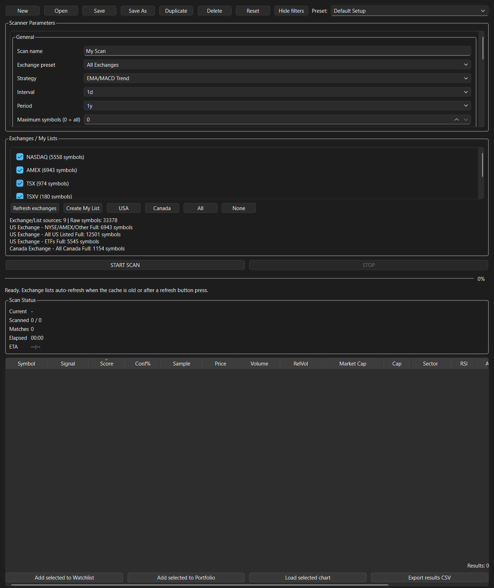
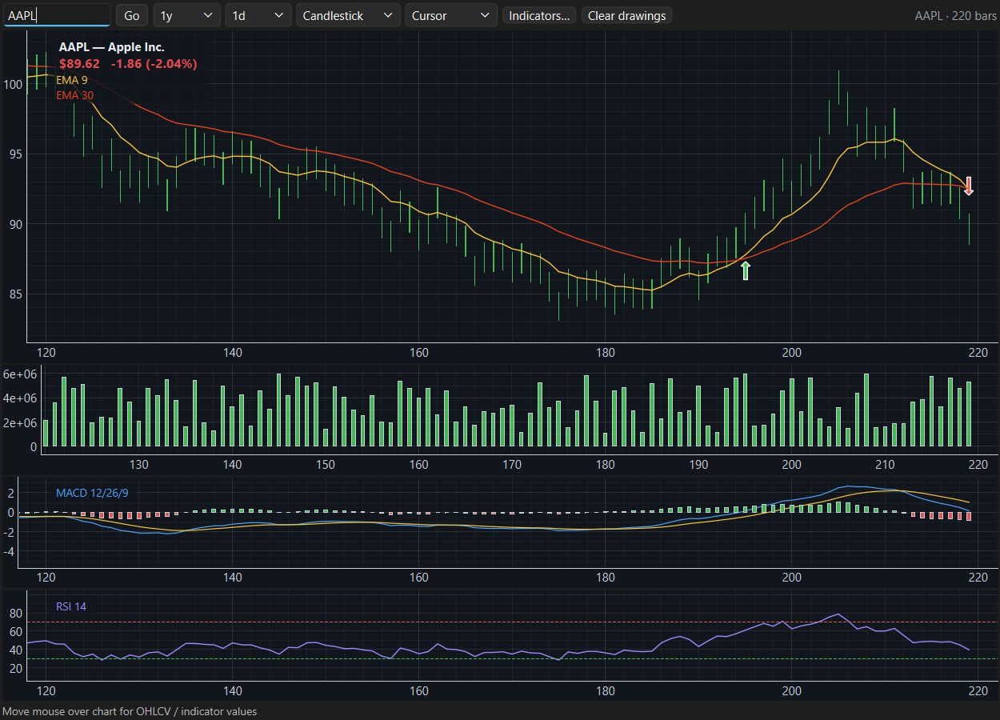
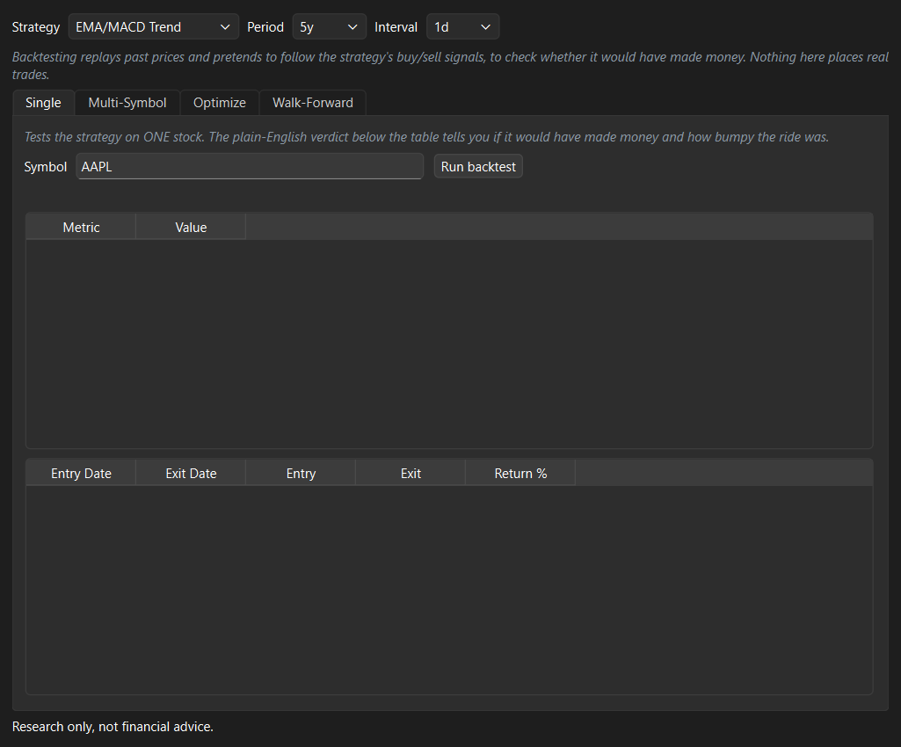
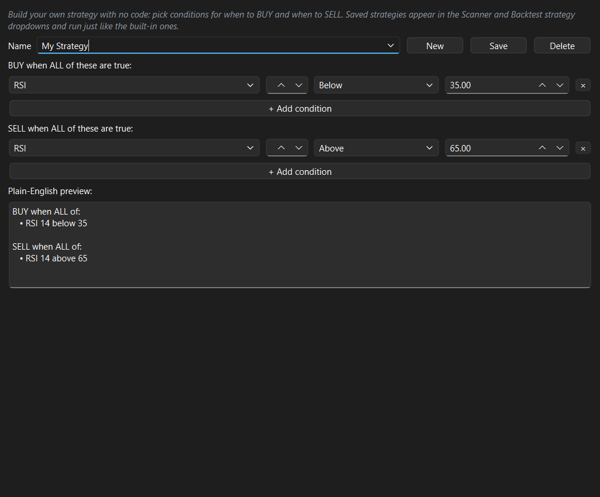
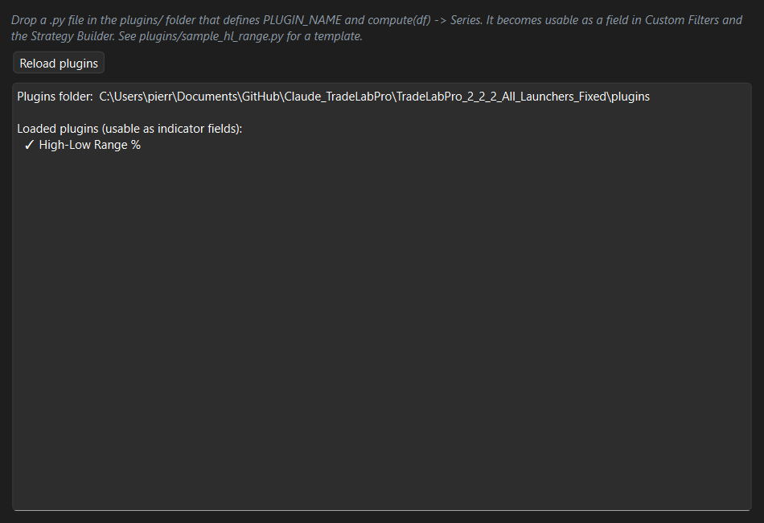
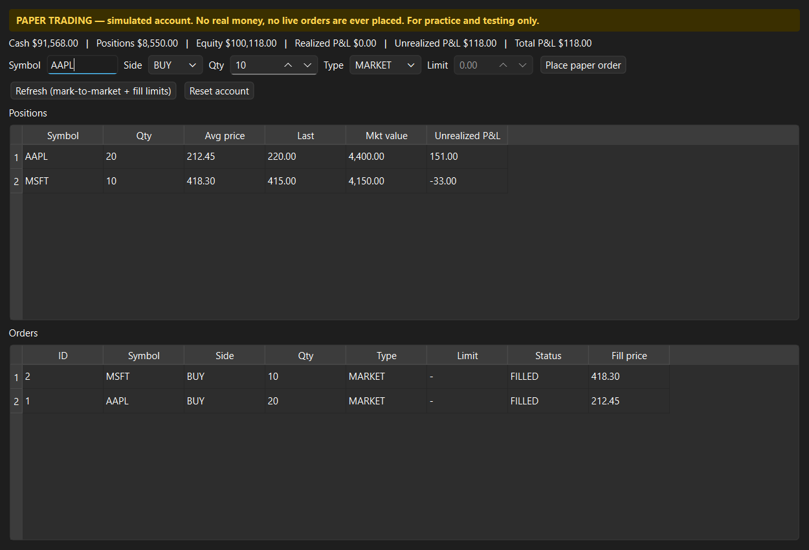
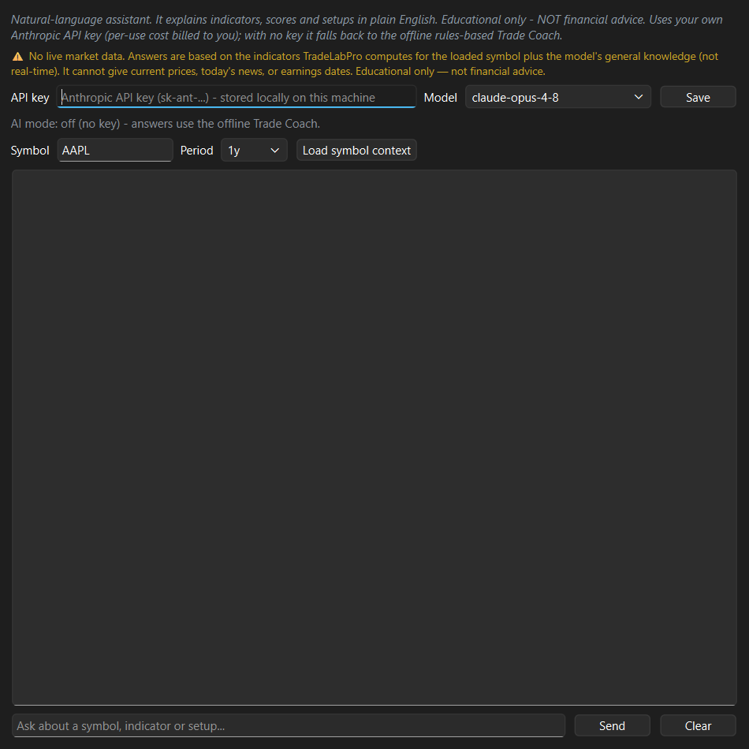

# TradeLab Pro — Manuel d'utilisation

**Version 2.72.1**

TradeLab Pro est un **poste de travail** pour le marché boursier, sur ordinateur :
il s'ouvre sur un tableau de bord **Accueil** qui montre vos comptes, un
graphique de leur année, la lecture du marché, les plus fortes variations du
jour et les dates prévues de vos titres. Il permet de balayer le marché à la
recherche de configurations, de tracer et d'analyser des symboles, de tenir des
listes de suivi et un portefeuille (**importer vos positions d'IBKR**, voir
l'**analyse du risque** en $ CA, lire vos FNB jusqu'aux **sociétés qu'ils
contiennent** et suivre les **dividendes** versés), de **projeter combien de
temps l'argent durera** à la retraite, de créer des **alertes** de prix ou
d'indicateurs, de voir tout un marché d'un coup d'œil sur une **carte
thermique**, de tester des stratégies sur l'historique, de construire vos
propres stratégies et indicateurs sans code, de **rejouer** l'historique barre
par barre, d'étudier la **saisonnalité** d'un symbole, de tenir un **journal de
transactions** (avec importation IBKR), de faire noter vos transactions par un
**Coach IA** sur la méthode, de **dimensionner vos positions selon le risque**,
de vous exercer avec un compte de négociation simulée, et de demander à un
assistant IA intégré d'expliquer ce que vous regardez.

> **Important — ce que l'application est et n'est pas.** TradeLab Pro est un
> outil d'**analyse et de pratique**. Il ne passe **aucun** ordre réel, ne se
> connecte à aucun courtier pour négocier et ne déplace pas d'argent réel. Tout
> ce qui touche la *négociation* dans l'application est **simulé**. (Il peut
> *lire* votre propre historique de transactions IBKR pour le journal — c'est
> un rapport en lecture seule, jamais un acheminement d'ordres.) Rien ici n'est
> un conseil financier. Faites toujours vos propres recherches et consultez un
> professionnel autorisé avant de risquer du capital réel.

---

## Table des matières

1. [Installation et lancement](#1-installation-et-lancement)
2. [La fenêtre principale](#2-la-fenêtre-principale)
3. [Démarrage rapide](#3-démarrage-rapide)
4. [Accueil](#4-accueil)
5. [Scanneur](#5-scanneur)
6. [Graphiques](#6-graphiques)
7. [Filtre de FNB et listes de suivi](#7-filtre-de-fnb-et-listes-de-suivi)
8. [Portefeuille, Analyse, Dividendes et Retraite](#8-portefeuille-analyse-dividendes-et-retraite)
9. [Alertes](#9-alertes)
10. [Carte thermique](#10-carte-thermique)
11. [Tableau de bord du marché](#11-tableau-de-bord-du-marché)
12. [Laboratoire de test historique](#12-laboratoire-de-test-historique)
13. [Relecture de graphique](#13-relecture-de-graphique)
14. [Saisonnalité](#14-saisonnalité)
15. [Constructeur de stratégies](#15-constructeur-de-stratégies)
16. [Modules](#16-modules)
17. [Négociation simulée](#17-négociation-simulée)
18. [Journal de transactions](#18-journal-de-transactions)
19. [Coach](#19-coach)
20. [Risque et taille de position](#20-risque-et-taille-de-position)
21. [Assistant IA](#21-assistant-ia)
22. [Paramètres et vos données](#22-paramètres-et-vos-données)
23. [Conseils et FAQ](#23-conseils-et-faq)
24. [Glossaire](#24-glossaire)

---

## 1. Installation et lancement

**Prérequis :** Windows, Python 3.11 ou plus récent (testé jusqu'à 3.14) pour
l'exécution à partir du code source. L'installateur, lui, n'a besoin de rien
d'autre.

**Première installation :**
1. Lancez `install_requirements.bat` pour installer les dépendances Python.
2. Démarrez avec `run_tradelab.bat` **ou** double-cliquez `START_TradeLabPro.vbs`.

L'application s'ouvre en plein écran et retient la taille et la position de sa
fenêtre d'une fois à l'autre.

**En ligne ou hors ligne (sources de données).** Par défaut, TradeLab Pro tire
ses données de marché de **Yahoo Finance** (`yfinance`) quand vous êtes
connecté. Sans Internet, il se rabat sur des **données synthétiques
déterministes** pour que chaque écran reste utilisable pour la pratique et les
démonstrations — les chiffres sont faux mais cohérents, donc rien ne plante ni
ne reste vide. Vous pouvez aussi **choisir la source** dans **Paramètres →
Source des données** (par exemple, forcer la source synthétique pour une
démonstration); voyez la section 22.

---

## 2. La fenêtre principale

La fenêtre est séparée en deux moitiés :

- **À gauche — le panneau à onglets.** **Accueil** vient en premier — vos
  comptes et le marché sur un seul écran — et les autres suivent le processus
  de négociation : **Marché → Carte thermique → Nouvelles** (contexte du
  marché) → **Scanneur → Filtre de FNB → Listes de suivi → Alertes** (trouver et
  surveiller) → **Assistant IA → Risque → Négociation simulée** (analyser,
  dimensionner et agir) → **Portefeuille → Analyse → Dividendes → Retraite →
  Simulation retraite → Journal → Coach** (suivre et revoir) → **Test
  historique → Stratégies → Relecture → Saisonnalité → Modules** (recherche et
  construction) → **Notes → Liens → Paramètres → Aide** (utilitaires). La barre
  d'onglets passe sur deux rangées pour que chaque onglet reste visible.
  **Aide** est ce manuel, dans un onglet — le même que **Aide → Manuel
  d'utilisation** (F1) ouvre dans sa propre fenêtre.
- **À droite — l'espace graphique.** Toujours visible, il suit l'onglet où vous
  êtes : les graphiques ouverts à partir du Scanneur, de la Carte thermique, du
  Journal ou de la Relecture (ou tapés directement) y apparaissent en panneaux
  détachables, tandis que **Simulation retraite** y dessine sa projection. Un
  bouton **⛶ Plein écran** agrandit le graphique à tout l'écran (Échap pour
  revenir).

Faites glisser le séparateur entre les deux moitiés pour répartir l'espace.
Chaque onglet défile de lui-même s'il lui faut plus de place que la hauteur de
la fenêtre, donc le bas d'un onglet est toujours accessible, quelle que soit la
taille de l'écran.

**Mode simple ou avancé.** Le mode *simple* ne montre que les onglets utiles
pour investir sereinement — **Guide, Accueil, Portefeuille, Simulation
retraite, Plan, Paramètres, Aide**; le mode *avancé* les montre tous,
négociation et recherche comprises. Changez avec le bouton au bout de la rangée
d'onglets, ou **Affichage → Mode avancé** (Ctrl+Maj+A). Rien n'est perdu dans
un cas comme dans l'autre : un onglet masqué garde ses données et revient tel
quel. Une nouvelle installation commence en mode simple; une installation qui a
déjà des portefeuilles commence en mode avancé. Le choix est retenu.

**Français ou anglais.** **Affichage → Language → Français** affiche TradeLab
en français (et **English** le remet en anglais); l'application offre de
redémarrer, car la langue s'applique au démarrage. Sont en français : les noms
des onglets, les menus, tous les onglets — simples et avancés —, les messages
que les onglets du mode simple écrivent au fur et à mesure (la liste de
vérification du Plan, les explications du Guide, le voyant du plan, le rappel
mensuel et l'avis en cas de baisse du marché) et ce manuel. Restent en anglais
: les lignes d'état que les onglets avancés écrivent pendant qu'ils travaillent,
les choix de leurs listes déroulantes (noms de stratégies, intervalles,
indicateurs) et les codes techniques (RSI, MACD, 1d…).

**Quand quelque chose ne va pas, une fenêtre le dit.** Un graphique sans
données, une importation qui échoue, une actualisation qui ne joint pas le
marché ou un lien qui ne s'ouvre pas affichent chacun une fenêtre Windows, en
plus de la ligne sous leur onglet — rien n'échoue en silence. Les problèmes qui
arrivent ensemble partagent une seule fenêtre.

Les **liens** (onglet Liens) s'ouvrent dans votre navigateur par défaut, qui
est ramené au premier plan : double-cliquez une ligne, ou choisissez des lignes
et cliquez **Ouvrir la sélection**. Si Windows ne peut en ouvrir un, la fenêtre
dit pourquoi et l'adresse est copiée, prête à coller dans le navigateur.

---

## 3. Démarrage rapide

Deux façons de commencer : **investir sereinement** dans un REER ou un CELI
(commencez ici si vous débutez), ou **négocier** avec les outils de recherche.
Les deux utilisent les mêmes données.

### Investir sereinement — commencez ici (environ 15 minutes)

1. **Installez et ouvrez.** Lancez l'installateur. TradeLab s'ouvre sur
   l'onglet **Guide**. Une nouvelle installation commence en **mode simple** :
   seulement les onglets utiles (le bouton au bout de la rangée d'onglets les
   montre tous).
2. **Ajoutez vos comptes.** Onglet **Portefeuille** → **Ajouter…** un
   portefeuille par compte, par exemple *REER IBKR* et *CELI IBKR*. Faites
   entrer ce que chacun contient : l'importation IBKR dans ce nom (cochez
   **Synchroniser ce portefeuille au démarrage** pour le garder à jour), et
   **Inscrire les liquidités** pour ses liquidités.
3. **Guide, étape 1 — Vous.** Répondez franchement, surtout à *la plus grande
   baisse que vous pourriez traverser sans vendre* : c'est elle qui décide le
   plus.
4. **Étape 2 — Votre niveau.** Lisez le tableau d'un bout à l'autre : ce que
   chaque niveau a rapporté *et* jusqu'où il a baissé dans les mauvaises années.
   Le niveau ★ est celui auquel mènent vos réponses. Choisissez le compte dans
   **Pour le portefeuille**, cliquez **Utiliser ce niveau** — il devient le
   mélange cible de ce compte dans l'onglet Plan. Faites-le pour chaque compte.
5. **Étape 3 — Vos fonds.** **Afficher : Un seul fonds pour votre niveau** est
   le choix le plus simple (un FNB tout-en-un qui se rééquilibre lui-même).
   Triez par **Frais les plus bas**, choisissez celui que vous voulez, puis
   **Ajouter la sélection à mes fonds**.
6. **Étape 4 — Vos achats.** **Utiliser ses liquidités inscrites** transforme
   les liquidités du compte en parts entières; **Copier la liste** et passez
   les ordres vous-même chez IBKR (un ordre à cours limité près du prix
   affiché). Cochez **Me le rappeler chaque mois le** si vous ajoutez de
   l'argent chaque mois.
7. **Ensuite, regardez simplement l'Accueil.** Le **voyant du plan** sous le
   titre : 🟢 sur la bonne voie, 🟡 ou 🔴 quelque chose mérite un coup d'œil —
   **Ouvrir l'onglet Plan** dit quoi, en dollars. Environ une fois par
   trimestre, lisez la liste de vérification de l'onglet Plan et cliquez
   **Marquer révisé aujourd'hui**.
8. **Quand le marché baisse,** TradeLab le dit à 10 %, 20 % et 30 %, à côté du
   propre historique de votre niveau : jusqu'où il a baissé et combien de temps
   il a pris pour revenir. C'est le moment de ne pas vendre.

Facultatif : **Simulation retraite** montre combien de temps l'argent durera et
le maximum que vous pouvez dépenser sans risque chaque année. Si vous faites de
la négociation à court terme dans votre REER ou votre CELI, mettez la catégorie
de ces titres à **trading** dans l'onglet Plan, pour qu'ils restent hors du
mélange et sous le plafond de négociation.

### Pour négocier — une visite de cinq minutes

Passez d'abord en **mode avancé** (le bouton au bout de la rangée d'onglets).

1. **Regardez l'Accueil.** Il est déjà chargé — la valeur de vos comptes, la
   variation du jour, le gain ou la perte non réalisé, le revenu annuel, ce qui
   demande votre attention et la lecture du marché. Rien à cliquer.
2. **Balayez.** Ouvrez l'onglet **Scanneur**, choisissez une bourse ou une liste
   (par ex. USA) et cliquez **Lancer le balayage**. Un tableau classé des
   symboles correspondants apparaît.
3. **Cartographiez.** Cliquez **🗺 Carte des résultats** pour voir ces symboles
   en **carte thermique** — taille selon la capitalisation, couleur vert/rouge
   selon la variation, regroupés par secteur.
4. **Graphique.** Double-cliquez une ligne du Scanneur (ou une tuile de la
   carte) — elle se charge dans le graphique à droite, avec le nom de la société
   et le prix en haut à gauche, les chandeliers, les moyennes mobiles et les
   sous-panneaux Volume/MACD/RSI.
5. **Gardez / alertez.** Ajoutez un symbole à une **liste de suivi** ou au
   **portefeuille**, ou ouvrez **Alertes** et réglez « RSI sous 30 » pour être
   averti quand cela arrive.
6. **Dimensionnez la transaction.** Ouvrez **Risque**, inscrivez la taille du
   compte, le % de risque, l'entrée et l'arrêt — il donne le nombre de parts à
   négocier et vos cibles en multiples de R.
7. **Pratiquez et tenez un journal.** Ouvrez **Négociation simulée**, achetez
   quelques parts fictives, puis le **Journal** pour revoir votre taux de
   réussite et votre espérance (ou importez votre vrai historique IBKR).
8. **Faites-vous coacher.** Ouvrez l'onglet **Coach** pour une note sur la
   qualité d'*exécution* de chaque transaction du journal — et une courte liste
   d'habitudes à travailler.
9. **Demandez.** Ouvrez l'**Assistant IA**, chargez le contexte d'un symbole et
   demandez « que me dit cette configuration? » en langage courant.

### Nouveau en placement? Le Guide

L'onglet **Guide**, premier de la rangée, accompagne un débutant une étape à la
fois. Il s'ouvre en premier tant que vous n'avez pas choisi de niveau; ensuite,
l'application s'ouvre sur l'Accueil.

**Étape 1 — Vous.** Quand vous aurez besoin de l'argent, quelle baisse vous
pourriez traverser sans vendre (une baisse de 20 % fait passer 10 000 $ à
8 000 $ pour un temps), quels comptes vous avez, le montant à placer maintenant
et chaque mois, et deux vérifications qui passent habituellement en premier :
quelques mois de dépenses de côté, et aucune dette coûteuse.

**Étape 2 — Votre niveau.** Six niveaux, de *Capital d'abord* (surtout
liquidités et obligations) à *Toutes actions*. Pour chacun :

- **Période** — depuis 2003, les 10 dernières années, les 3 dernières années
  ou la dernière année : le rendement, la pire baisse, les pires 12 mois et
  votre argent la suivent tous, donc une période plus courte laisse de côté les
  vieux krachs. Une période de moins de 10 ans affiche un avertissement : elle
  peut manquer un krach complètement. Le niveau marqué ★ est toujours jugé sur
  la pire baisse depuis 2003, 2008 compris.
- **A fait par an** — ce que le mélange a vraiment rapporté sur la période, en
  $ CA : des fonds indiciels dans un mélange mondial typique (Canada 30 %,
  États-Unis 45 %, international 20 %, émergents 5 % — XIU, SPY, EFA, EEM, ceux
  cotés aux États-Unis au taux de change de chaque mois, non couverts comme dans
  un FNB tout-en-un), obligations XBB, liquidités à 2,4 % stable, rééquilibré
  chaque mois. Ils représentent les actions et les obligations; ce ne sont pas
  des choix.
- **Normes, par an** — ce que les planificateurs financiers doivent supposer :
  les Normes d'hypothèses de projection 2026 de FP Canada et de l'Institut de
  planification financière (revenu fixe 3,2 %, court terme 2,4 %, actions
  canadiennes 6,3 %, américaines 6,4 %, internationales 6,6 %, émergentes
  7,5 %), moins des frais de fonds indiciel de 0,25 %. Elles sont volontairement
  prudentes — bien sous ce que ces mélanges ont fait depuis 2003.
- **Votre argent dans … ans** — ce que vos montants deviendraient, au rendement
  de la période, ou à celui des normes quand **Période** est réglée sur les
  normes des planificateurs.
- **Pire baisse, pires 12 mois, pires 5 ans** — ce qui est vraiment arrivé sur
  la période, avec les mêmes fonds (les pires 5 ans demandent une période de
  plus de 5 ans).

Le niveau auquel mènent vos réponses est marqué ★ : le plus élevé dont la vraie
pire baisse reste dans ce que vous avez dit pouvoir traverser, et pas plus haut
que votre horizon ne le permet — avec la raison en une phrase. Vous pouvez en
choisir un autre; un niveau au-dessus de vos réponses dit ce que cela implique,
et le choix reste le vôtre.

**Utiliser ce niveau** enregistre votre choix et, pour le portefeuille choisi,
en fait le mélange cible dans l'onglet **Plan** — qui montre alors l'écart du
portefeuille et ce qu'il faudrait pour y arriver.

**Étape 3 — Vos fonds.** Ce qui pourrait contenir votre niveau, côte à côte. La
ligne d'introduction répartit votre montant selon le mélange du niveau (par
exemple, Équilibré sur 300 000 $ : actions 180 000 $, obligations 120 000 $).
**Afficher** choisit quoi comparer :

- **Un seul fonds pour votre niveau** — les FNB tout-en-un qui détiennent ce
  mélange et se rééquilibrent eux-mêmes (XEQT / VEQT / ZEQT pour toutes
  actions, XGRO / VGRO / ZGRO pour croissance, XBAL / VBAL / ZBAL pour
  équilibré, et ainsi de suite; FNB d'épargne pour Capital d'abord). Le moins de
  travail, et le moins de façons de se tromper.
- **Blocs** — un fonds par partie : liquidités et épargne, obligations à court
  terme, obligations toutes échéances, actions canadiennes, actions canadiennes
  à dividendes, actions américaines (S&P 500), actions internationales, actions
  mondiales hors Canada. Plus de contrôle; vous les rééquilibrez vous-même, et
  l'onglet Plan dit quand. Chaque bloc dit en une ligne ce qu'il est — les FNB
  de dividendes, par exemple, restent des actions.

Chaque candidat est vérifié sur les prix réels, dividendes compris, en $ CA :
frais, niveau de risque, pire baisse et quand, rendements sur 1, 5 et 10 ans, et
le compte qui lui convient. **Vérifier aussi** ajoute d'autres symboles à la
comparaison; **Trier par** classe selon les frais, la pire baisse, le risque ou
les rendements. Les candidats sont des FNB indiciels larges d'iShares, de
Vanguard et de BMO — TradeLab les trie selon votre choix et n'en choisit jamais
un. Choisissez ceux que vous voulez et cliquez **Ajouter la sélection à mes
fonds** : ils vont dans **Mes fonds**, la liste que l'étape 4 achète (**Retirer
de mes fonds** en enlève un). Mes fonds est enregistré avec votre niveau.

**Étape 4 — Vos achats.** Votre argent transformé en parts entières, pour le
portefeuille choisi à l'étape 2 :

- **Placer maintenant** part du montant de l'étape 1; **Utiliser ses
  liquidités inscrites** prend les liquidités que l'onglet Portefeuille a pour
  ce portefeuille. **Puis chaque mois** est le montant mensuel.
- **Part %** — la part de l'argent de chaque fonds, selon votre niveau : un
  seul fonds prend tout; les blocs se partagent leur catégorie (deux fonds
  d'actions dans Équilibré reçoivent 30 % chacun). Changez n'importe quelle part
  à la main; le reste jusqu'à 100 % demeure en liquidités, et une catégorie sans
  fonds choisi est nommée pour que vous puissiez en ajouter un.
- **Acheter maintenant / Coût / Puis chaque mois** — des parts entières au
  dernier cours de clôture. Un fonds sous sa part reçoit l'argent en premier,
  donc rien n'est jamais vendu; ce que le portefeuille détient déjà d'un fonds
  compte, et ce qui reste achète des parts une à une pour le fonds le plus en
  retard. Un fonds coté aux États-Unis est évalué en $ CA au taux du jour.
- **Copier la liste** place les ordres dans le presse-papiers, à garder à côté
  de l'écran d'ordres de votre courtier.
- **Me le rappeler chaque mois le** — une notification Windows avec l'achat du
  mois (la part de chaque fonds du montant mensuel), une fois par mois, la
  première fois que TradeLab est ouvert ce jour-là ou après.

Vous passez les ordres vous-même (un ordre à cours limité près du prix affiché
évite les surprises); TradeLab ne négocie jamais.

**Calme dans une baisse.** Pendant que TradeLab est ouvert (au démarrage, puis
toutes les six heures), il surveille les actions mondiales — XEQT, un FNB
tout-en-un d'actions, en $ CA — par rapport à leur sommet de la dernière année.
À une baisse de 10 %, puis de 20 %, puis de 30 %, une notification Windows le
dit une seule fois, à côté du propre historique de votre niveau : jusqu'où il a
baissé au pire depuis 2003 et combien de mois il a pris pour revenir à son
sommet (Équilibré : −23 % en 2007–2009, revenu en octobre 2010). Vendre après
une baisse la transforme en perte définitive; le plan n'a pas changé. Quand la
baisse redescend sous 5 %, le compte recommence. Sans niveau choisi,
l'historique est celui de Toutes actions.

Aucun niveau n'offre un rendement élevé sans risque : plus un niveau peut
rapporter, plus il a baissé dans les mauvaises années. Le Guide montre les deux
côte à côte pour que le choix se fasse en connaissance de cause. Il ne nomme
jamais un titre et ne dit jamais d'acheter ou de vendre.

---

## 4. Accueil

Le premier onglet, et la première chose que vous voyez. Il répond aux questions
pour lesquelles vous ouvrez vraiment l'application, sans rien avoir à cliquer :
**combien valent mes comptes, comment ont-ils bougé aujourd'hui, quel revenu
s'en vient, qu'est-ce qui a le plus bougé, qu'est-ce qui approche, et y a-t-il
un problème?**

**Il s'actualise au démarrage.** Votre portefeuille se charge dès que la
fenêtre s'affiche; la lecture du marché suit quelques secondes plus tard en
arrière-plan. Le temps de regarder la fenêtre, les chiffres sont déjà là.

**Votre plan, en un voyant.** La ligne sous le titre est la liste de
vérification de l'onglet Plan sous forme de voyant : 🟢 *sur la bonne voie*;
🟡 un ou deux points à voir — le premier est nommé; 🔴 trois ou plus, ou des
dépenses au-dessus du budget sécuritaire. À côté, la date de votre prochain
achat mensuel quand le rappel du Guide est réglé. **Ouvrir l'onglet Plan** mène
directement au détail. Le voyant apparaît une fois le plan vérifié (quelques
secondes après le démarrage, ou quand vous actualisez l'onglet Plan).

### Les tuiles

**Valeur du portefeuille** · **Aujourd'hui** · **Gain/perte non réalisé** ·
**Revenu annuel** — dans votre devise d'affichage (**CAD** par défaut; changez
en haut à droite). **Valeur du portefeuille** inclut les **liquidités**
inscrites dans l'onglet Portefeuille (section 8), pour se lire comme la valeur
de compte que montre votre courtier; survolez-la pour la répartition entre
positions et liquidités. La ligne sous le titre dit quand l'Accueil a été
actualisé et de quelle séance datent ses **prix**.

**Valeur nette** ajoute à vos comptes les régimes suivis dans l'onglet
**Retraite** (un REER collectif, par exemple), chacun selon son dernier relevé;
survolez-la pour le détail. Un régime dans une autre devise est listé à part,
jamais additionné sans conversion.

### Historique enregistré

Chaque fois que l'Accueil évalue l'ensemble de vos comptes, TradeLab
**enregistre leur valeur de la journée** (liquidités comprises; une valeur par
jour, la dernière). Choisissez **Historique enregistré** dans la case
**Graphique** pour la voir : contrairement à l'année estimée ci-dessous, c'est
ce que le compte valait vraiment — un dépôt ou un retrait y apparaît donc comme
un mouvement. Rien n'est enregistré quand un titre n'a pas de prix ou qu'une
devise n'a pu être convertie, pour que l'historique ne contienne jamais une
journée trompeuse. L'onglet **Simulation retraite** montre la dernière valeur
enregistrée à côté des soldes de départ de son plan.

### Cette année

Un graphique de ce que vos comptes ont valu depuis le début de l'année, dans
votre devise d'affichage. La ligne est **verte quand l'année est en hausse,
rouge quand elle est en baisse**; la ligne pointillée marque le départ de
l'année, et l'en-tête donne le mouvement en dollars et en pourcentage avec la
**plus forte baisse** en chemin. Survolez la ligne pour lire la valeur d'une
journée et son écart par rapport au départ.

L'année est ancrée à la **dernière clôture de l'an dernier** quand l'historique
de prix remonte jusque-là, donc le premier mouvement de janvier se mesure à
partir de la vraie fin d'année des comptes plutôt qu'à partir de leur première
barre.

> **C'est un graphique de ce que vous détenez, pas un relevé de compte.** Il
> évalue **les quantités d'aujourd'hui** à chaque clôture depuis janvier — une
> position ouverte en mars est donc évaluée jusqu'en janvier comme si vous
> l'aviez toujours eue, et **les cotisations, retraits, transactions de l'année
> et dividendes reçus n'y sont pas**. Une position importée d'IBKR a une
> quantité et un prix moyen, mais **aucune date de transaction**; rien de plus
> précis n'est donc possible avec ces données, et la note sous le graphique le
> dit chaque fois plutôt que de laisser prendre la ligne pour un relevé.

Deux autres précisions. Les comptes ne sont évalués que les jours où **chaque**
titre s'est négocié, donc un titre inscrit en cours d'année raccourcit la
courbe — le graphique **nomme alors le titre** en cause au lieu de commencer
l'année en mars sans rien dire. Et dans les premiers jours de janvier, avant
qu'il y ait assez de séances, il le dit plutôt que de tracer une ligne entre
deux points.

### À surveiller

Ce qu'il vaut la peine de savoir sans avoir à le demander :

- Un titre **en baisse de plus de 5 %** dans la journée.
- Un symbole **sans données de prix**, ou un **taux de change manquant** —
  nommé, pour que vous sachiez ce qui est exclu plutôt que de vous demander
  pourquoi un total semble bas.
- Une position qui dépasse **40 % des comptes**.
- La **concentration transparente** — une société qui atteint 40 % des comptes
  une fois vos fonds ouverts, même si aucune *position* n'est aussi grande.
  Voyez la section 8.

### Plus fortes variations du jour

Le mouvement de chaque titre, du plus grand au plus petit. Le **pourcentage est
le mouvement du titre dans sa propre devise**, pour qu'une variation de change
ne le fausse pas; le **montant en dollars est converti** dans votre devise
d'affichage. Cliquez une ligne pour son graphique.

### Revenu

Le revenu moyen par mois, et le prochain versement attendu — quel titre, quel
mois, à peu près combien.

### À venir

Les dates prévues de vos propres titres — quand chacun **publie ses résultats**
et quand chacun se négocie **ex-dividende** :

> **À venir :** POW.TO publie dans 3 jours · KTOS publie dans 8 jours · RY.TO
> publie dans 31 jours · +1 autre

Ce qui arrive dans les trois jours est mis en évidence. Seules les premières
dates sont listées; les autres sont comptées.

**Ce qui est laissé de côté, exprès :**

- **Les dates passées.** Un ex-dividende de la semaine dernière appartient au
  passé, ce n'est rien sur quoi agir.
- **Les dates à plus de 45 jours.** Au-delà d'environ six semaines, une date
  est une anecdote plutôt qu'une chose à savoir aujourd'hui, et les dates de
  résultats estimées aussi loin bougent souvent.
- **Tout ce qui n'est pas vraiment publié.** Rien ici n'est déduit ni estimé.

**Une ligne tranquille est normale.** Les FNB n'ont pas de résultats et la
plupart ne publient aucun calendrier, donc des comptes surtout en fonds ont
réellement peu à montrer. Plutôt que de laisser un silence à interpréter, la
ligne **nomme** les titres qui n'avaient rien : *« Aucun calendrier publié pour
VTI, XDIV.TO, XIC.TO — les fonds en ont rarement un. »* Ainsi, un calendrier
vide n'a jamais l'air d'une recherche brisée.

> **Pas de calendrier économique.** L'IPC, l'IPP, les décisions des banques
> centrales et les changements de recommandation des analystes ne sont
> volontairement **pas** inclus. Aucune source de données branchée à
> l'application ne les publie de façon fiable, et une liste de dates codée en
> dur se périme sans prévenir — une mauvaise date sur un écran qui parle
> d'argent réel est pire que pas de date du tout.

### Le marché, en trois lignes

- **Marché** — la lecture de chaque marché noté (États-Unis, Canada), avec
  l'ampleur, le VIX et le secteur le plus fort et le plus faible.
- **Monde** — TSX, S&P 500, Nasdaq, FTSE et Nikkei, le marché local en premier.
- **Macro** — USD/CAD, pétrole, or et taux américain à 10 ans : le taux par
  lequel passent vos titres en USD, les deux matières premières qui dominent le
  TSX, et le rendement auquel chaque payeur de dividendes est comparé.

Deux choses à savoir sur ces lignes. Elles montrent **les propres chiffres de
l'onglet Marché** — l'Accueil ne calcule jamais une deuxième version, moins
chère, donc les deux écrans ne peuvent pas se contredire. Et une lecture porte
**son âge** : « mis à jour 16 h 25 » quand elle est fraîche, « au 16 h 25 » une
fois qu'elle a plus d'une heure, pour qu'un chiffre périmé ne soit jamais
présenté comme actuel. Tant qu'aucune lecture n'existe, la ligne dit *« lecture
du marché… »* plutôt que d'afficher un chiffre bidon.

Le taux à 10 ans est donné en **points de base** (« −4 pb »), pas en variation
en pourcentage du rendement, et n'est volontairement pas coloré — vert pour une
hausse laisserait croire que des taux en hausse sont une bonne nouvelle, ce qui,
pour des payeurs de dividendes, est d'habitude le contraire.

> **L'Accueil assemble, il ne recalcule jamais.** La valeur des comptes vient du
> même moteur que l'onglet Analyse et le revenu du même moteur que l'onglet
> Dividendes, donc un chiffre de l'Accueil correspond toujours à l'onglet d'où
> il vient. Si un prix ne peut être obtenu, l'Accueil affiche « — » plutôt
> qu'un solde inventé.

---

## 5. Scanneur

Le Scanneur filtre le marché pour ne garder que les symboles qui répondent à
vos critères et les classe selon une **note** de 0 à 100.



### Lancer un balayage
1. Choisissez les symboles à balayer avec les sélecteurs de **bourses / listes**
   (raccourcis : USA, Canada, Tout, Aucun; vos propres listes sont sous **Mes
   listes**; les FNB sont sous Mes listes, pas sous Bourses).
2. Réglez vos filtres (ci-dessous).
3. Cliquez **Lancer le balayage**. **Arrêter** interrompt un long balayage.

### Filtres
- **Prix / Volume / Capitalisation** — bornes minimale et maximale.
- **Volume relatif, plage de RSI, plage d'ATR %** — barrières de momentum et de
  volatilité.
- **Tendance EMA / MACD positif** — exiger une condition de tendance.
- **Filtres personnalisés** — ajoutez vos propres conditions sur plus de 16
  champs techniques (prix, volume, RSI, ATR %, ADX, famille MACD, EMA, SMA,
  bandes de Bollinger, prix par rapport à la SMA20 en %, et les modules
  d'indicateurs ajoutés). Chacune est Above / Below / Between une valeur
  (au-dessus, sous, entre), et toutes s'ajoutent (ET) aux filtres fixes.
- **Stratégie** — la liste choisit la stratégie qui note et signale chaque
  symbole (par ex. EMA/MACD Trend, RSI Mean-Reversion, ou une stratégie que vous
  avez construite). C'est elle qui remplit les colonnes Signal et Note.

### Lire les résultats
Colonnes : **Symbole, Signal, Note, Conf%, Échantillon, Prix, Volume, VolRel,
Capitalisation, Cap., Secteur, RSI, ATR%, EMA, MACD**.

- **Note (0–100)** — la lecture globale de la stratégie; les lignes sont
  colorées par palier de note.
- **Signal** — BUY / SELL / neutre (achat, vente, neutre) selon la stratégie
  choisie.
- **Conf% / Échantillon** — parmi les signaux d'achat passés de la stratégie
  sur ce symbole, la part qui était gagnante 10 barres plus tard, et sur combien
  de signaux cela repose. Un Conf% élevé sur un gros échantillon est plus fiable
  qu'un seul sur un tout petit. Un tiret (—) veut dire pas assez d'historique.
- **Cap.** — catégorie Mega / Large / Mid / Small / Micro.
- Les lignes en erreur (note 0) s'affichent en gris, avec le message d'erreur
  dans l'info-bulle du symbole — un échec de balayage ne passe jamais pour un
  résultat faible.

Double-cliquez une ligne pour son graphique. Les boutons dessous ajoutent les
lignes choisies à une liste de suivi ou au portefeuille, chargent un graphique,
exportent les résultats, ou **🗺 Carte des résultats** — qui envoie les
résultats à l'onglet **Carte thermique** comme carte personnalisée (section 10).
La ligne d'état résume les comptes et la répartition par secteur.

### Préréglages
La liste **Préréglage** enregistre, change et supprime des réglages de
balayage nommés (gardés dans `data/setups/`). « Enregistrer sous » en crée un
nouveau; la liste se tient à jour d'elle-même. **Ouvrir** charge un fichier de
réglage d'ailleurs sur le disque. Vous pouvez aussi **exporter** les résultats.

---

## 6. Graphiques

L'espace graphique à droite affiche des graphiques réactifs et zoomables
(construits avec PyQtGraph).



### Charger et naviguer
- Chargez un symbole en double-cliquant un résultat du Scanneur, en cliquant une
  tuile de la carte thermique, ou en tapant un symbole dans la boîte de
  recherche du graphique.
- Les sélecteurs **Période** et **Intervalle** règlent la longueur de
  l'historique et la taille des barres.
- **Déplacez** en faisant glisser, **zoomez** avec la molette, et lisez les
  valeurs exactes avec la **croix** — une lecture synchronisée sur les panneaux
  prix, Volume, MACD et RSI montre la date et l'heure, les valeurs OHLCV
  complètes et les indicateurs dans la barre d'état du bas.

### L'en-tête de prix
En haut à gauche du panneau de prix :
```
AAPL — Apple Inc.
212,45 $   +1,32 (+0,63 %)
```
Le nom de la société, puis le **dernier prix** et sa **variation sur la
veille** (vert en hausse, rouge en baisse). C'est la dernière clôture de
l'historique chargé, pas un prix en continu.

### Types de graphique
**Chandeliers, Heikin-Ashi, Ligne, Aire.**

### Indicateurs
Cliquez une entrée de la **légende** du graphique (en haut à gauche) pour
ouvrir la fenêtre **Indicateurs** — la légende *est* la porte d'entrée. De là,
vous pouvez :
- Ajouter ou retirer des **superpositions** à périodes réglables : EMA, SMA,
  Bollinger, VWAP, points pivots, SuperTrend, nuage d'Ichimoku, profil de volume
  et les modules d'indicateurs.
- Afficher ou masquer les sous-panneaux **Volume / MACD / RSI** et régler leurs
  périodes. Un bouton « Afficher tous les sous-panneaux » remet ceux masqués par
  erreur.
- Afficher les marqueurs de **signal BUY/SELL** (croisement d'EMA confirmé par
  le MACD).

### Marqueurs de dividendes
Pour un symbole qui verse un dividende, chaque **date ex-dividende** est marquée
d'un petit losange sous sa barre — survolez-le pour voir le montant versé par
part. Le **rendement des 12 derniers mois** apparaît aussi dans l'en-tête, à
côté du prix, par ex. `46,42 $   +0,24 (+0,52 %)   ·   Rendement 3,02 %`. Les
deux viennent du même calcul que l'onglet Dividendes, donc les deux écrans
concordent toujours. Désactivez-les dans la fenêtre **Indicateurs** (*Afficher
les marqueurs de dividendes*). Un titre qui ne verse rien n'affiche ni l'un ni
l'autre.

### Outils de dessin
Ligne de tendance, ligne horizontale, ligne verticale, rectangle, **retracement
de Fibonacci** et notes texte. Les dessins sont **enregistrés par symbole et
par unité de temps**, donc ils sont toujours là quand vous revenez.

### Plusieurs graphiques et dispositions
Ouvrez plusieurs graphiques côte à côte en panneaux détachables; une rangée de
boutons (sous la barre d'outils) en a un par graphique ouvert, avec un petit
bouton de fermeture (×) sur chacun et un bouton **Réinitialiser les
graphiques** pour revenir à un seul. Vous pouvez enregistrer et recharger des
**dispositions** nommées.

---

## 7. Filtre de FNB et listes de suivi

Le **Scanneur** trouve des configurations à négocier. Le **Filtre de FNB**
répond à la question plus lente qui précède un placement à long terme — *quel
fonds, et combien* — et il est fait pour la façon dont on y répond vraiment :
comparer une douzaine de fonds côte à côte et ajuster les pourcentages jusqu'à
ce que le mélange semble juste. Il est placé entre le Scanneur et les listes de
suivi parce que c'est là que la décision se prend.

**Le tableau.** Une ligne par fonds, une colonne par point de comparaison : nom,
catégorie, région, ce que le fonds détient au **Canada / aux États-Unis / à
l'international / en obligations / en marchandises**, le **RFG**, le
**rendement des distributions**, les rendements **d'un mois à dix ans**, la
**volatilité**, la **pire baisse**, le niveau de **risque**, des **notes**
libres et le **compte** où vous le détiendriez.

**Ce que veut dire « Risque » ici.** Chaque fonds et FNB vendu au Canada doit
coter son risque selon une mesure prescrite et l'imprimer dans son *Aperçu du
fonds* : l'écart-type annualisé des rendements **mensuels** sur **dix ans**,
classé en cinq niveaux — sous 6 % *Faible*, 6–11 *Faible à moyen*, 11–16
*Moyen*, 16–20 *Moyen à élevé*, 20 et plus *Élevé*. Cette colonne calcule le
même chiffre à partir des mêmes prix, pour que vous puissiez le comparer au
document du fonds plutôt que de croire l'application sur parole. **Survolez la
cellule** pour voir l'écart-type et le nombre d'années utilisées.

Deux choses qu'elle n'est pas. Ce n'est **pas** la colonne Volatilité à côté :
celle-ci mesure au jour le jour sur tout l'historique d'un fonds, la bonne
mesure pour comparer les fonds dans l'application et la mauvaise pour ces
niveaux — VFV donne 16,5 % au quotidien mais 12,9 % selon la méthode de
l'autorité, ce qui change de niveau. Et elle ne cote **que la volatilité** : pas
le risque de crédit, la liquidité, la concentration, la devise ni la
possibilité d'une perte permanente. Un fonds d'obligations tranquille est coté
*Faible* jusqu'au jour où un émetteur fait défaut.

Un fonds qui n'a pas dix ans est coté sur ce qu'il a, et l'info-bulle le dit;
la méthode officielle complète un historique court avec un indice de référence,
ce que celle-ci ne fait pas, donc un jeune fonds peut différer de son document.
Sous trois ans, rien n'est coté.

**% Marchandises** est la case de ce qui n'a pas de géographie — des lingots
dans un coffre. Les sociétés qui *extraient* ces métaux sont des actions et vont
dans les colonnes régionales, avec le thème nommé dans la catégorie. Les fonds
d'or, d'argent et de lithium vont là où cette règle les place. Cliquez une
cellule d'une colonne qui vous appartient et tapez. Les pourcentages s'écrivent
comme vous les dites — `20`, `20%` et `62.5 %` veulent dire la même chose — et
la cellule se réaffiche en `20.0%` pour que ce que vous avez tapé et ce qui est
enregistré ne puissent pas différer. Effacer un nombre n'enregistre rien plutôt
que zéro : une case vide veut dire « inconnu », alors qu'un zéro fausserait
chaque total qui l'utilise.

La **colonne Symbole reste figée** à gauche : défilez de trente colonnes vers la
droite et vous voyez toujours à quel fonds appartient le ratio de Sharpe que
vous lisez. **Double-cliquez un symbole** pour charger le fonds dans le
graphique — c'est le symbole *Yahoo* qui est tracé, donc `VFV.TO` plutôt que
`VFV`, celui qui a des prix.

**Ajouter et retirer.** Tapez un symbole, facultativement celui que **Yahoo**
connaît (les titres du TSX finissent par `.TO`), et **Ajouter**. Si la case
Yahoo reste vide, le symbole est utilisé tel quel. **Retirer la sélection**
supprime les lignes surlignées. Les boutons passent sur une deuxième rangée
quand vous élargissez le graphique, plutôt que de sortir de l'écran.

**Rendements et risque en un clic.** **Actualiser rendements et risque**
télécharge onze ans d'historique pour chaque fonds et recalcule les colonnes de
rendement — annualisées au-delà d'un an, dividendes réinvestis — ainsi que la
volatilité, la pire baisse et le ratio de Sharpe. Le calcul tourne en
arrière-plan avec une barre de progression et un bouton **Arrêter**; un fonds
que Yahoo ne reconnaît pas est compté et sauté plutôt que d'arrêter le tout.
**L'actualisation ne touche jamais ce que vous avez tapé** : catégorie, poids,
risque, notes et répartitions vous appartiennent.

**Chaque colonne de répartition se totalise sous le tableau** — vert quand elle
atteint 100 %, ambre sinon. Le bouton **⛶ Plein écran** donne toute la fenêtre
au tableau en masquant le graphique; cliquez de nouveau pour le remettre.

**Construire… remplit une colonne selon une règle.** Plutôt que de taper trente
poids, choisissez la colonne, cochez les **niveaux de risque publiés**
admissibles, choisissez **poids égaux** ou **inverse de la volatilité** (les
fonds plus calmes reçoivent plus), fixez un plafond par fonds, et décidez s'il
faut ne garder qu'un de deux fonds qui achètent le même marché — le moins cher,
puisqu'une même exposition à moindre coût est une règle et non une préférence.
Un aperçu montre exactement ce qui sera écrit avant d'écrire quoi que ce soit.

Tout ce que la règle utilise est déjà une colonne du tableau, et chaque choix
vous appartient : l'application fait de l'arithmétique, elle ne choisit pas de
fonds. Les niveaux sont cochés d'avance selon le *nom* de la colonne que vous
remplissez, ce qui n'est qu'une correspondance de noms — changez-les.
Ensuite, chaque cellule reste modifiable, et la colonne entière est remplacée
plutôt que fusionnée, pour qu'un poids d'un essai précédent ne survive pas dans
un mélange où la règle ne met plus ce fonds.

**Trois répartitions côte à côte.** **Risque faible**, **Risque moyen** et
**Risque élevé** sont des colonnes de poids à remplir, totalisées sous le
tableau : ce que chacune détient par région, son RFG pondéré, son rendement
pondéré des distributions, son rendement pondéré sur dix ans, et si les poids
totalisent 100 % (`OK ✓` ou *ajuster*). Changez un poids et les totaux suivent.
La liste **Répartition** décide sur laquelle des trois portent les analyses
ci-dessous.

**Deux choses que l'onglet refuse de faire.** Un fonds inscrit il y a cinq ans
n'a **pas** de rendement sur dix ans, donc cette case reste vide au lieu
d'annualiser un historique qu'il n'a pas — et une actualisation qui ne peut
calculer un chiffre laisse celui qui est déjà là plutôt que de l'effacer. Et
quand un total ne repose que sur une partie de votre répartition, il le dit —
`(de 50 % de la répartition)` — car compter à zéro les fonds sans ce chiffre
ferait paraître votre mélange pire qu'il ne l'est.

**Trois questions auxquelles l'onglet peut répondre sur une répartition.**
Choisissez-la dans la liste **Répartition**, puis :

- **Cible vs détenu** évalue les positions de votre onglet **Portefeuille** et
  les place à côté de la cible : de combien chaque fonds s'est écarté, et les
  dollars qu'il faudrait pour combler l'écart. Les pourcentages portent sur
  **l'ensemble des comptes**, et tout ce que vous détenez sans cible est nommé —
  un plan mesuré seulement sur les fonds qu'il mentionne dirait les comptes
  conformes alors que la moitié serait ailleurs. Le montant en dollars est de
  l'arithmétique sur votre propre cible; il ne sait rien des commissions, de
  l'impôt sur une vente ni de l'intérêt de la transaction.
- **Ce que contient ce mélange** ouvre chaque fonds jusqu'aux sociétés qu'il
  contient. Une banque détenue dans trois fonds indiciels est une seule
  exposition, pas trois. Les sources ne publient que les plus gros titres de
  chaque fonds, donc le reste est déclaré non réparti plutôt qu'étalé sur les
  noms à l'écran — chaque pourcentage est un minimum. Un fonds qui n'est qu'une
  enveloppe d'un autre fonds est ouvert **deux fois** : VFV.TO publie un seul
  titre, VOO.TO à 100 %, et répondre « vous détenez VOO.TO » serait vrai et
  inutile.
- **Comparer la sélection** trace les fonds surlignés sur un même graphique,
  chacun ramené à 100 à la première date qu'ils ont *tous* en commun, pour que
  les lignes répondent à une seule question : lequel a le plus monté sur la
  même période.

**La colonne Faible vol. est un test que vous réglez.** Tapez un seuil à côté de
**Faible vol. ≤** et chaque fonds dont la volatilité annualisée *mesurée* est
égale ou inférieure est coché. C'est de l'arithmétique sur deux nombres — votre
seuil et la volatilité calculée par l'actualisation — donc c'est répétable et
cela change dès que vous bougez le seuil. Elle marque les fonds qui passent;
elle ne dit jamais combien en détenir et ne remplit pas les colonnes de
répartition. Un fonds jamais actualisé affiche **—** : non mesuré, ce qui n'est
pas la même chose qu'échouer au test. Dès qu'un fonds passe, la liste de filtre
gagne une entrée *Passe le test de faible vol.*

**Un avertissement de chevauchement apparaît de lui-même**, sous les totaux,
quand deux fonds de la répartition achètent le même marché et ont tous deux du
poids (VCN et XIC, VIU et XEF). C'est un seul marché à deux fois les frais de
négociation plutôt qu'une diversification — à moins que vous ne les déteniez
exprès dans des comptes différents.

**Ajouter la sélection à la liste de suivi / au portefeuille** fonctionnent
comme dans le Scanneur. Un fonds ajouté au portefeuille arrive à **0 part** :
cet onglet sait ce que vous voulez détenir, jamais ce que vous avez vraiment
acheté. **Exporter (CSV)** écrit chaque colonne dans ses unités enregistrées (un
taux est `0.25`, pas `25.0%`) pour qu'un chiffrier reçoive le nombre et non la
mise en forme. La boîte **Filtrer** restreint le tableau par symbole, nom,
catégorie, région ou notes, et la liste à côté offre les valeurs que le tableau
contient vraiment — chaque catégorie, région, compte et devise. Dessous se
trouvent les entrées d'**exposition** (*Détient le Canada*, *Détient les
États-Unis*, *Détient de l'or*…), qui lisent les colonnes de pourcentage plutôt
que l'étiquette de région : XAW est étiqueté *Mondial* et est à 60 % américain,
donc l'étiquette seule le cacherait d'une recherche d'exposition américaine.
Les deux filtres se combinent, et filtrer masque des lignes sans changer les
totaux — ce que vous voyez et ce que vous détenez sont deux choses.

**Les notes du bas** indiquent quels titres en $ CA remplacent quels fonds
américains (XUU pour VTI, QQC pour QQQ, MNT pour IAU, etc.) et lesquels n'ont pas
de jumeau en $ CA au même rendement. C'est le raisonnement derrière le choix
d'un seul fonds d'une paire plutôt que des deux — un texte de référence, pas une
recommandation.

**Partir d'un classeur existant.** `python tools/import_etf_screener.py
<fichier.xlsx>` charge une feuille de la forme de `Portefeuille_FNB.xlsx` dans
l'onglet en une passe (en-têtes à la ligne 7). L'opération est idempotente — la
lancer deux fois ne duplique rien — mais c'est une *importation*, pas une
synchronisation : les valeurs du fichier écrasent les cellules correspondantes
de l'application. Un classeur en français est **traduit à l'entrée**
(catégorie, région, compte et notes par fonds), pour que le tableau ne devienne
pas une grille anglaise pleine de cellules françaises; ce que la table de
traduction ne connaît pas est repris mot pour mot plutôt que deviné. Nécessite
`pip install openpyxl`.

Les niveaux de risque et le compte suggéré sont vos propres notes et un guide
général, pas l'opinion de l'application ni un conseil fiscal.

### Listes de suivi

Suivez les symboles qui vous intéressent. Le tableau montre **Élément, Symbole,
Dernier, Variation %, Rôle**. Vous pouvez importer et exporter des listes.
Ajoutez des symboles directement des résultats du Scanneur, ou par clic droit
sur une tuile de la **carte thermique** → *Ajouter à la liste de suivi*. Choisir
une entrée peut la charger dans le graphique.

---

## 8. Portefeuille, Analyse, Dividendes et Retraite

L'onglet **Portefeuille** est un registre de titres : **ID, Portefeuille,
Symbole, Parts, Entrée**. Ajoutez des positions (par ex. à partir d'un résultat
du Scanneur), regroupez-les par nom de portefeuille et exportez; **cliquez une
ligne pour voir le graphique de son symbole**. C'est un registre de **tenue de
livres** pour des positions détenues ailleurs — il ne passe ni ne suit aucun
ordre réel. Votre portefeuille alimente aussi la **carte thermique** (carte du
portefeuille) et la vue d'exposition sectorielle de l'onglet **Risque**. Pour
saisir des ordres simulés et suivre le gain ou la perte, utilisez la
**Négociation simulée** (section 17).

**Les portefeuilles par nom.** La rangée **Portefeuille** du haut les liste —
un par compte, comme *REER IBKR* et *CELI IBKR* :

- **Ajouter…** en crée un, même vide (un CELI ouvert mais pas encore approvisionné),
  pour lui donner tout de suite un mélange cible dans l'onglet Plan ou le Guide.
- **Renommer…** emporte tout : positions, liquidités, mélange cible,
  synchronisation au démarrage, et les choix de l'onglet Plan et du Guide qui le
  nomment. Un nom déjà utilisé est refusé, pour que deux portefeuilles ne soient
  jamais fusionnés par accident.
- **Retirer…** demande d'abord et dit ce qui serait supprimé (positions,
  liquidités, mélange cible); une sauvegarde de l'onglet Paramètres peut le
  ramener.

**Ajouter une position** place la position dans le portefeuille choisi là.

### Importer vos positions d'IBKR (lecture seule)

Plutôt que de taper vos titres, vous pouvez récupérer vos positions ouvertes
directement d'Interactive Brokers. Dans l'onglet Portefeuille, sous **Importer
d'IBKR** :

- **Fichier de positions (CSV/XML)…** — exportez un relevé d'activité ou un
  rapport Flex qui contient la section **Open Positions** (CSV ou XML) et
  choisissez le fichier.
- **Récupérer les positions (Flex)** — une récupération directe par le service
  Web Flex d'IBKR, avec le **jeton et le numéro de requête** enregistrés dans
  l'onglet Journal (section 18). La section Open Positions de votre requête Flex
  doit contenir au moins Symbol, Quantity et Cost Price (ajoutez aussi Currency
  et Listing Exchange pour la meilleure correspondance). Ajoutez sa section
  **Cash Report** (avec Currency et Ending Cash) et les liquidités suivent aussi.

Les titres importés vont dans le portefeuille nommé dans la case **dans** à côté
des boutons — **IBKR** à moins que vous tapiez un autre nom. Utilisez un nom par
compte IBKR (par exemple *IBKR* et *REER*) : chaque importation **remplace** ce
que ce portefeuille contenait, donc réimporter ne crée jamais de doublons, et vos
autres portefeuilles ne sont pas touchés.

**Les liquidités viennent avec les positions** quand le rapport a une section
Cash Report — un relevé d'activité en a une par défaut. Les liquidités de fin
par devise remplacent alors celles inscrites pour ce portefeuille, pour qu'une
devise que le compte ne détient plus ne traîne pas. Un rapport sans cette
section laisse les liquidités inscrites telles quelles : une section absente
n'est pas un compte vide. La fenêtre de confirmation dit quel cas s'applique
avant d'écrire quoi que ce soit — pas de section Cash Report (ajoutez-la à la
requête Flex dans IBKR, ou inscrivez les liquidités à la main dans la section
**Liquidités**), ou une section que TradeLab n'a pas pu lire. Chaque
récupération Flex garde le rapport d'IBKR tel qu'envoyé dans le dossier des
journaux (`ibkr_positions_last.xml`, sur votre ordinateur seulement), pour
qu'une section illisible puisse être examinée.

**Tout vendu?** Un rapport dont la section Open Positions est vide offre de
vider le portefeuille. Un rapport sans cette section ne change rien et le dit.

**Synchroniser au démarrage.** Choisissez le portefeuille dans la case **dans**
et cochez **Synchroniser ce portefeuille au démarrage** : dès lors, chaque
lancement récupère son rapport Flex en arrière-plan et remplace ce portefeuille
par son contenu — sans rien demander — puis l'Accueil et l'onglet Plan
réévaluent les comptes. Faites-le une fois par compte IBKR (un REER, un CELI) :
chaque portefeuille peut avoir son propre **numéro de requête** (vide : celui
du Journal), et ils se synchronisent l'un après l'autre. Une récupération
ratée laisse le portefeuille tel quel et dit pourquoi dans une fenêtre. Les
rapports Flex sont bâtis sur les données de fin de journée d'IBKR, donc une
transaction faite aujourd'hui apparaît le lendemain.

> **Lecture seule.** Ceci lit ce que vous détenez — il ne se connecte jamais
> pour négocier, n'achemine aucun ordre et ne déplace aucun fonds.

**Correspondance des symboles.** IBKR donne des symboles locaux nus, qui peuvent
pointer vers la mauvaise inscription dans la source de données (par ex. `XDIV`
américain à environ 30 $ contre `XDIV.TO` à Toronto à environ 46 $ — et certains
titres américains ont même un « CDR » canadien au même symbole). L'importation
associe chaque titre à la bonne inscription selon sa bourse et sa devise et, en
dernier recours, en comparant le prix de chaque candidat à votre prix coûtant,
pour que des comptes mixtes canadiens et américains soient bien évalués.

### Liquidités

Un compte détient des liquidités à côté de ses positions, et votre courtier les
compte dans sa valeur. Inscrivez-les sous le tableau des positions : choisissez
le **portefeuille**, la **devise** (un code de trois lettres comme CAD ou USD) et
le **montant**, puis cliquez **Inscrire les liquidités**. Inscrire de nouveau le
même portefeuille et la même devise remplace le montant; **Retirer les
liquidités sélectionnées** supprime une ligne. Un montant négatif est un prêt
sur marge : il est dû, donc il réduit le total.

L'Accueil et l'Analyse ajoutent les liquidités à vos positions, converties dans
la devise d'affichage, pour que leur total corresponde à la valeur de
liquidation nette de votre courtier. Seulement le total : le gain ou la perte
non réalisé, les poids et les mesures de risque décrivent toujours ce qui est
investi. Les liquidités tapées restent telles quelles — mettez-les à jour quand
elles changent, ou laissez une importation IBKR les tenir à jour (ci-dessus).

### Analyse — le profil de risque de vos comptes

L'onglet **Analyse** traite vos titres comme un tout. Choisissez un **indice de
référence** (SPY par défaut), une période d'**historique** et une **devise**
d'affichage (**CAD** par défaut), puis cliquez **Analyser**. Il récupère les
prix en arrière-plan et montre :

- **Tuiles de mesure** — la valeur totale (vos positions plus les liquidités
  inscrites dans l'onglet Portefeuille; survolez pour le détail), le gain ou la
  perte non réalisé, le rendement comparé à l'indice (les deux nommés, par ex.
  « +47,0 % vs SPY +19,2 % »), le bêta, la volatilité annualisée et la baisse
  maximale. La ligne sous les tuiles dit de quelle séance datent les prix.
- **Tableau des titres** — la devise propre de chaque position (**Devise**), le
  dernier prix, la valeur marchande, le poids dans les comptes, le gain ou la
  perte non réalisé, et son **rendement** sur la période choisie. **Cliquez une
  ligne pour voir le graphique du symbole.**
- **Concentration** — la plus grosse position, la part des trois premières et le
  *nombre effectif de positions* (des comptes répartis également sur 5 noms ont
  un N effectif de 5; un compte dominé par un seul nom en a bien moins).
- **Matrice de corrélation** — comment les rendements quotidiens de vos titres
  bougent ensemble (rouge = ils bougent en bloc, risque concentré; vert = ils se
  diversifient), plus la corrélation moyenne par paire.

**Devises (comptes multidevises).** L'affichage reprend la façon dont IBKR
montre un compte en plusieurs devises :
- **Les prix par part restent dans leur devise** — Dernier et Entrée moyenne
  montrent le vrai cours de chaque titre (un titre américain montre son prix
  américain, celui que vous reconnaissez).
- **Les montants en dollars sont dans la devise choisie** (CAD par défaut) —
  valeur marchande, coût, gain ou perte non réalisé et total sont convertis au
  taux de change du jour, pour que — avec vos liquidités inscrites — le total
  corresponde à la liquidité nette de votre courtier et que tout se compare.

**Les prix du jour, même quand Yahoo est en retard.** Après la clôture, Yahoo
peut prendre des heures à publier la barre quotidienne. Évalués sur la clôture
de la veille, les comptes auraient un jour de retard, et l'Accueil appellerait
« aujourd'hui » le mouvement d'hier. Donc, quand la dernière transaction d'un
titre (selon les barres de 5 minutes du jour) est d'une séance plus récente que
son historique quotidien, l'Accueil, l'Analyse et les Dividendes utilisent
plutôt cette transaction. La date **des prix** affichée avec chaque total est
la séance du plus vieux prix utilisé.
- **Latent %** est le mouvement de prix propre au titre (sans effet de change),
  et choisir **Native (mixte)** montre plutôt chaque titre entièrement dans sa
  propre devise.

**Latent % ou rendement.** Deux questions différentes : **Latent %** est *votre*
gain depuis votre prix d'entrée; le **rendement** est la performance du titre
lui-même sur la période choisie, peu importe quand vous avez acheté — à
comparer directement au rendement de l'indice sur la même période. Un titre
peut afficher un gros rendement mais un petit latent % si vous avez acheté en
cours de route.

**Franc sur les données manquantes.** Si le téléchargement d'un prix échoue —
un titre, l'indice ou un taux de change —, l'Analyse affiche « — » et nomme le
symbole dans une note (« Aucune donnée de prix pour X — exclu des totaux »)
plutôt que de substituer les données synthétiques hors ligne utilisées ailleurs
pour les démonstrations. De même, le gain ou la perte non réalisé exclut le coût
d'un titre sans prix, et si l'historique court d'un titre raccourcit la période
commune d'analyse, l'onglet le dit (« ⚠ Période raccourcie par l'historique
limité de SYMBOLE »).

> Analyse seulement — l'onglet Analyse ne passe ni ne suit aucun ordre réel, et
> ses chiffres ne sont pas un conseil financier.

### Exposition transparente — vos comptes par société, pas par position

Des comptes mesurés position par position peuvent sous-estimer ce qu'ils
détiennent vraiment. Si vous détenez une banque directement **et** deux FNB
indiciels qui ont chacun cette banque comme premier titre, c'est **une seule
exposition concentrée présentée comme trois expositions diversifiées**.

La section **Exposition transparente** (sous le tableau des titres, remplie quand
vous cliquez **Analyser**) ouvre vos fonds et réexprime les comptes par
*société* :

| Colonne | Ce qu'elle veut dire |
| --- | --- |
| **Société** | La société sous-jacente, détenue directement, dans un fonds, ou les deux |
| **Exposition** | Sa valeur totale par toutes les voies où vous la détenez |
| **% du total** | Cette valeur en part de l'ensemble des comptes |
| **Détenu directement** | La part qui est votre propre position (« — » si vous ne la détenez que par un fonds) |
| **Aussi dans** | Lesquels de vos fonds la contiennent |

**Cliquez une ligne pour son graphique** — y compris les sociétés que vous ne
détenez que dans un fonds, sans position directe.

Sous le tableau, une ligne **Secteurs** donne les poids sectoriels de l'ensemble
des comptes : les fonds apportent leur répartition sectorielle publiée, les
titres individuels leur propre secteur, et ce qui n'est pas classé reste visible
plutôt que d'être discrètement écarté.

**Un exemple.** Des comptes en $ CA avec XDIV, XIC et RY directement : RY
apparaît comme une **position de 28 %** dans le tableau des titres, mais **33 %
du total** en vue transparente — parce que les deux FNB ont RY comme plus gros
titre. XDIV est la plus grosse *position*; RY est la plus grosse *société*. Deux
questions différentes, deux réponses différentes.

> **Chaque chiffre ici est un minimum, jamais un total.** Les sources de données
> ne publient que les **quelque 10 premiers titres** d'un fonds, donc ce qui est
> en dessous est déclaré à part comme non réparti plutôt qu'étalé sur les noms
> que vous *voyez* — ce qui les surestimerait tous. La section dit combien reste
> non attribué. Un fonds sans aucune donnée de titres est **nommé** et compté
> comme lui-même, pour que les comptes ne paraissent jamais plus diversifiés que
> les données ne le permettent.

### Dividendes — le revenu que versent vos comptes

L'onglet **Dividendes** répond à « que me versent vraiment mes titres? ».
Choisissez une **devise** d'affichage (CAD par défaut) et cliquez
**Actualiser** :

- **Tuiles principales** — le **revenu annuel** total, la **moyenne par mois**,
  le **rendement du portefeuille**, le **rendement sur le coût**, et combien de
  titres versent quelque chose.
- **Revenu par titre** — la **fréquence** de versement de chaque position
  (mensuelle, trimestrielle, …), son **dividende par part** pour l'année, le
  **revenu annuel** qu'elle produit, son **rendement**, son **rendement sur le
  coût** et sa **croissance**. Cliquez une ligne pour le graphique du symbole.
- **Quand il arrive** — un calendrier mois par mois du revenu attendu, ombré
  pour faire ressortir les gros mois, avec les titres qui versent chaque mois.

**Rendement ou rendement sur le coût.** Le *rendement* est le dividende divisé
par le prix du jour — ce qu'obtient quelqu'un qui achète maintenant. Le
*rendement sur le coût* divise par ce que **vous** avez payé, donc il est plus
élevé quand le prix a monté depuis votre achat; il est mis en évidence quand
votre prix coûtant est le plus avantageux. Les deux sont calculés dans la devise
propre de chaque titre, donc la devise d'affichage ne les change pas.

**Comment le chiffre annuel est calculé.** L'application annualise le **dernier
versement** selon sa fréquence détectée, plutôt que d'additionner simplement les
douze derniers mois. Ainsi, une hausse (ou une baisse) récente se voit tout de
suite au lieu d'être diluée par des versements plus anciens et plus petits.

> **Une projection, pas une promesse.** Le calendrier et le chiffre annuel sont
> extrapolés à partir des versements passés. Une société peut augmenter,
> réduire ou suspendre un dividende en tout temps. Rapport seulement — pas un
> conseil financier.

### L'onglet Retraite — un régime d'employeur auquel l'application ne peut se connecter

Un REER collectif ou un régime de retraite est le seul compte que TradeLab ne
peut pas récupérer. Ses fonds n'ont ni symbole ni prix public : les valeurs
unitaires vivent derrière l'accès de l'administrateur du régime et nulle part
ailleurs. L'onglet **Retraite** est construit autour de la seule donnée qui
existe vraiment — ce que dit votre relevé, quelques fois par année — et il ne
demande jamais votre mot de passe.

**Collez votre relevé.** Copiez le tableau des fonds directement du site du
régime dans la case *Inscrire un relevé* : un fonds par ligne, titres de
catégorie ignorés. Une ligne avec deux nombres est lue comme unités et valeur
unitaire; un seul nombre est lu comme un solde. Le format canadien fonctionne
(`12 049,25 $`), l'américain aussi (`1,234.56`). Cliquez **Lire** pour voir ce
qui a été compris — **rien n'est enregistré avant de cliquer Enregistrer**.
Coller de nouveau la même date corrige ce relevé plutôt que d'en ajouter une
deuxième copie.

**Collez vos fiches de fonds.** La plupart des régimes publient, par fonds, son
rendement par rapport à **son propre indice** sur 3 mois à 10 ans. C'est mieux
que tout ce que l'application peut calculer : c'est le vrai indice du fonds,
souvent un mélange qu'aucun FNB ne reproduit, sur des horizons qu'on ne pourrait
jamais reconstituer à partir des relevés. Collez le tableau des rendements
composés d'une fiche — la ligne d'en-tête et les lignes *Fonds* / *Indice* —,
choisissez le fonds et cliquez **Lire la fiche**.

**Inscrivez les frais du régime. C'est ce qui change les réponses.** Les
rendements des fiches sont calculés **avant** les frais de gestion du régime.
Tapez ces frais une fois et chaque écart gagne un jumeau *Après frais*. Un fonds
qui bat son indice de 0,03 point et coûte 1,5 % ne l'a pas battu pour vous — il
a perdu d'environ 1,5 point. Sans la colonne des frais, ce fonds a l'air d'un
gagnant.

**Ce que coûtent les frais, en dollars.** Sous la case des frais, fixez des
frais plus bas pour comparer (0,25 % par défaut, un fonds indiciel à faible
coût) et un rendement avant frais (5 % par défaut). La ligne dit combien coûtent
de plus les frais du régime cette année, et l'écart après 10 et 20 ans si les
deux croissaient à ce rendement sans ajout ni retrait. Une illustration selon
vos hypothèses : transférer un régime collectif peut avoir des conditions
(cotisations de l'employeur, frais de transfert), donc renseignez-vous avant de
décider.

**Deux rendements, qui répondent à des questions différentes.**

| Colonne | Ce qu'elle veut dire | Quand l'utiliser |
|---|---|---|
| **Rendement du fonds** | Le mouvement de la valeur unitaire. Vos cotisations ne peuvent l'embellir. | Comparer vos fonds entre eux |
| **Votre rendement** | Un TRI sur ce que vous avez versé et quand | Voir comment votre propre argent s'en est tiré |

Les cotisations de l'employeur sont suivies à part : une contrepartie de 100 %
est un avantage de rémunération, pas une performance de placement, et mélanger
les deux gonfle le chiffre.

**Le graphique** ramène chaque fonds à 100 à son premier relevé, donc celui qui
traîne est la ligne du bas — aucun chiffre à lire. Il n'utilise que les valeurs
unitaires : un solde en dollars monte quand vous cotisez, et le tracer comme une
performance induirait en erreur.

> **Un relevé, c'est un solde, pas un rendement.** Avec une seule date, chaque
> colonne de rendement affiche « — » avec la raison. C'est de l'arithmétique,
> pas un bogue — un prix n'implique pas un rendement, il en faut deux. Votre
> premier collage démarre le chronomètre; le deuxième répond à la question.

> **Ce qu'il ne fera pas.** Il ne se connectera pas à votre régime, et il ne vous
> dira pas quel fonds détenir. Rendements, indices et frais sont placés côte à
> côte comme des faits. Rapport seulement — pas un conseil financier.

### L'onglet Simulation retraite — combien de temps l'argent durera

L'onglet **Retraite** à côté *suit* un régime : ce qu'il a valu, ce qu'il a
rapporté. **Simulation retraite** *projette*. À partir de ce que vous détenez et
de ce que vous supposez, il écrit une ligne par année civile — revenus, minimum
FERR obligatoire, vrai impôt québécois **et** fédéral, et ce qui doit sortir du
capital pour couvrir les dépenses — jusqu'à l'âge que vous indiquez.

**Trois tableaux à remplir.** Ajoutez et retirez des lignes avec les boutons
sous chacun.

| Tableau | Colonnes | Notes |
| --- | --- | --- |
| **Personnes** | Nom, Âge, Droits CELI | Une ligne par personne. Chaque **Titulaire** ailleurs doit correspondre exactement à un nom ici, sinon l'application ne sait pas quel âge s'applique. **Droits CELI** sont les droits de cotisation inutilisés de la personne aujourd'hui — Mon dossier de l'ARC les montre; vide compte pour aucun. |
| **Comptes** | Compte, Type, Solde, Titulaire | Le **type** est `registered` (REER/FERR/FTQ), `tfsa` (CELI) ou `taxable` (non enregistré). Les soldes acceptent `$` et les virgules — `$164,000` se lit bien. |
| **Revenus** | Revenu, Titulaire, Par an, Début, Fin, Indexé | **Par an** est sa valeur **d'aujourd'hui**. **Début** / **Fin** sont l'âge du titulaire; une fin vide veut dire à vie. Un salaire est simplement un revenu qui se termine. |

**La colonne Indexé décide si un chèque augmente.** `Yes` (ou une case vide —
le cas courant) veut dire qu'il suit l'inflation, comme la RRQ, la PSV et l'AOW
selon la loi. Tapez `No`, `non` ou `fixe` pour une rente privée fixe : elle
verse le même nombre de dollars pendant trente ans, et perd environ la moitié de
sa valeur en chemin.

**Attendre augmente la RRQ et la PSV, et la projection l'applique.** Pour un
revenu nommé **RRQ** ou **PSV**, tapez le montant à 65 ans et l'âge de début :
un début plus tardif ajoute ce que la loi donne pour l'attente — la RRQ **+0,7 %
par mois** jusqu'à 72 ans (+58,8 %), la PSV **+0,6 % par mois** jusqu'à 70 ans
(+36 %), rien de plus ensuite. Essayer une PSV à 70 ans tient donc dans une
case, pas dans un calcul. La ligne d'état nomme chaque rente commencée plus tard
et la hausse reçue. Une RRQ commencée **avant** 65 ans est utilisée telle que
tapée : sa réduction dépend du montant de la rente, que seul votre relevé de
Retraite Québec connaît. Que l'attente soit payante dépend de combien de temps
vous vivrez, ce qu'aucune projection ne peut dire.

**Les contrôles du haut.**

| Contrôle | Ce qu'il fait |
| --- | --- |
| **Dépenses** | Les dépenses du ménage par année, en dollars d'aujourd'hui — elles suivent ensuite l'inflation. **La donnée qui change le plus le résultat.** |
| **% rendement** | Le rendement tel qu'un fonds le publie, inflation comprise. 5 veut dire cinq pour cent. |
| **% infl.** | L'inflation, projetée explicitement. Elle fait croître les prestations indexées, les dépenses et les paliers d'impôt. |
| *= x,xx % réel* | Ce que le rendement laisse après l'inflation. Formule de Fisher, pas une soustraction : 5 % avec 2 % d'inflation font **2,94 % réel**, pas 3 %. |
| **% vol** | À quel point le rendement varie d'une année à l'autre — utilisé seulement par **Lancer plusieurs scénarios**. |
| **jusqu'à** | Jusqu'où projeter. L'horizon va de l'âge de la personne la plus âgée jusqu'à celui-ci. |
| **% fractionnement** | La part du revenu de pension admissible à transférer au conjoint au revenu le plus bas (0–50 %). |
| **$ d'aujourd'hui** | Lire le tableau fini en pouvoir d'achat d'aujourd'hui plutôt qu'en dollars de chaque année. Voir plus bas. |
| **scénarios** | Combien d'ordres de rendements **Lancer plusieurs scénarios** utilise. |

**Ce que donne une simulation.** *Lancer la projection* remplit le tableau du
bas — **Année, Âges, Revenu, Minimum FERR, Impôt, Récupération PSV, Du capital,
Réinvesti, Au CELI, Non financé, Solde final** — et trace le solde final dans le
panneau de droite, là où est normalement le graphique. Une année que le plan ne
peut financer est en rouge, et **la projection continue au-delà de l'année où
elle échoue** plutôt que de s'arrêter et de vous laisser deviner la suite. La
ligne d'état dit jusqu'à quel âge l'argent dure, ou à quel âge il manque et de
combien.

*Revenu* ne compte que vos revenus; le retrait obligatoire a sa propre colonne,
pour voir ce qui est arrivé parce que vous en aviez besoin et ce qui est arrivé
parce que la loi l'exige. Le capital est puisé **dans l'ordre où les comptes
sont listés** — réordonnez les lignes pour le changer. Rien ici ne choisit une
stratégie de retrait à votre place.

**Un retrait d'un compte enregistré paie son propre impôt.** L'argent sorti d'un
REER/FERR/FTQ est un revenu de son titulaire, donc combler un manque de
10 000 $ demande plus de 10 000 $ : la projection calcule combien de plus, avec
les vrais paliers et les crédits que le retrait réduit, et **Du capital** montre
le montant brut. C'est traité comme un versement de FERR — un revenu de pension
admissible dès 65 ans, donc fractionnable. Un retrait du CELI n'est pas un
revenu et sort tel quel.

**L'argent non dépensé est gardé.** Quand le revenu de l'année après impôt
dépasse les dépenses — un salaire qui rentre encore, ou un minimum FERR non
requis —, la différence est épargnée, et la colonne **Réinvesti** montre
combien :

- **D'abord au CELI**, tant qu'il y a des droits — **Au CELI** montre cette
  part. Les droits sont ceux de chaque personne aujourd'hui (tableau
  Personnes), plus le nouveau plafond de chaque année pour chaque personne —
  7 000 $ en 2026, indexé à l'inflation et arrondi aux 500 $ près comme le fait
  la loi — plus les retraits du CELI de l'année précédente.
- **Le reste dans un compte non enregistré.** Sa croissance est imposée chaque
  année comme un gain en capital — la moitié est un revenu imposable, déclaré
  l'année suivante — et une perte est reportée sur les gains suivants.
  L'imposer chaque année est un peu tôt pour un investisseur qui achète et
  garde, jamais en retard : la reporter laisserait une facture d'impôt cachée
  dans le solde final.

Les deux sont puisés **en dernier**, après tous les comptes listés — l'imposable
d'abord, le CELI ensuite. (Avant 2.51.0, un retrait d'un compte enregistré pour
couvrir les dépenses n'était pas imposé, ni la croissance de l'argent épargné,
donc les projections étaient optimistes. Avant 2.48.0, l'argent épargné
disparaissait carrément, ce qui les rendait pessimistes.)

**Quels dollars vous lisez.** La projection tourne dans les dollars de l'année
où chaque chose arrive : la RRQ croît comme elle le fait vraiment, les dépenses
suivent, et les soldes sont les chiffres qui figureraient sur un relevé. Le
prix à payer : « 1,2 M$ en 2055 » n'est un chiffre que personne ne peut évaluer
— cochez donc **$ d'aujourd'hui** et la même simulation est relue en pouvoir
d'achat d'aujourd'hui. Elle est *relue*, pas relancée : chaque ligne porte son
propre facteur d'inflation, donc les deux vues ne peuvent jamais différer sur ce
qui s'est passé, seulement sur la façon de l'évaluer. La case s'applique aussi
aux bandes des scénarios multiples et au graphique, y compris une simulation
gardée il y a des mois.

**L'impôt est un vrai modèle, pas un taux.** Chaque chiffre de 2026 a été lu sur
canada.ca et revenuquebec.ca, et chacun porte sa source. Chaque personne est
imposée **comme une personne** — deux montants personnels de base valent plus
qu'un —, avec le montant en raison de l'âge dès 65 ans, le montant pour revenu
de retraite, la réduction québécoise du montant en raison de l'âge selon le
revenu **familial** net, et l'abattement du Québec. Les paliers sont indexés
comme le reste, parce que les deux gouvernements indexent les leurs; les figer
inventerait une hausse d'impôt qui n'arrivera pas. **Seul le revenu de pension
admissible est fractionné** : un salaire ne peut pas l'être, et la RRQ a son
propre mécanisme.

**La récupération de la PSV est dans l'impôt.** Au-delà d'un seuil de revenu —
95 323 $ pour 2026, indexé —, 15 % du revenu net de chaque personne au-dessus du
seuil est remboursé, jamais plus que la PSV reçue. Elle est calculée après le
fractionnement du revenu de pension, puisque transférer ce revenu au conjoint
est justement ce qui la réduit, et la colonne **Récupération PSV** montre la
part de l'**impôt** qu'elle représente — le chiffre qui sert à décider quand
commencer la PSV pendant qu'un salaire rentre encore. Un revenu compte comme
PSV quand il est nommé **PSV**, **SV** ou **OAS** (ou Sécurité de la vieillesse,
Old Age Security). Le remboursement est lui-même déductible, ce qui n'est pas
modélisé : le chiffre est un peu élevé, jamais trop bas.

**Le minimum FERR obligatoire.** Dès l'année où son titulaire atteint 71 ans, un
compte enregistré verse le minimum prescrit par l'ARC, que les dépenses l'aient
demandé ou non, et il est imposable pour **le titulaire de ce compte** — les
minimums d'un couple sont deux chiffres différents, pas un seul.

**Lancer plusieurs scénarios.** Un rendement moyen ne dit rien de l'*ordre* dans
lequel les rendements arrivent, et c'est l'ordre qui décide d'un décaissement :
perdre 20 % dans les deux premières années de retraits n'est pas la même chose
que dans les deux dernières, car l'argent retiré au creux ne revient jamais.
Cette fonction fait tourner le même plan sur des centaines d'ordres et donne
**Pires 10 % / Médiane / Meilleurs 10 %** par année, plus la part des scénarios
**encore solvables**, avec la bande 10–90 ombrée derrière la médiane sur le
graphique. Le tirage est déterminé, donc les mêmes données donnent deux fois la
même réponse.

**Budget sécuritaire.** Calcule le maximum que le plan peut dépenser par année
(en dollars d'aujourd'hui, suivant l'inflation) jusqu'à son dernier âge, de deux
façons : si chaque année rapportait exactement le **rendement** inscrit plus
haut, et — celui sur lequel planifier — pour que **90 % de 300 ordres de
rendements simulés** (avec la **% vol** inscrite) ne manquent jamais d'argent.
La ligne sous les tableaux le compare à vos **dépenses** : vert avec la marge
restante, ambre quand les dépenses sont à moins de 10 % du budget, rouge (et une
fenêtre) quand elles le dépassent. Les vrais krachs peuvent être plus profonds
que ce que la % vol laisse croire, donc gardez une marge. Un calcul selon vos
hypothèses, pas un conseil.

**Ordre des retraits.** Fait tourner le plan en puisant dans chaque type de
compte — REER/FERR, CELI, non enregistré — dans tous les ordres, et liste dans
une fenêtre ce que chacun laisse à la fin, l'impôt payé sur la projection et la
récupération de la PSV comprise (en dollars d'aujourd'hui), et quand l'argent
s'épuise. ★ marque l'ordre qui laisse le plus. Le minimum FERR est retiré quel
que soit l'ordre; seul ce qui est retiré au-delà suit l'ordre. On compare des
ordres, pas d'autres stratégies (comme retirer plus dans une année à faible
impôt). Un calcul, pas un conseil.

**Meilleur fractionnement.** Avec deux personnes, fait tourner le plan avec 0 %
à 50 % du revenu de pension admissible (versements de FERR dès 65 ans, rente
d'un régime) transféré au conjoint au revenu le plus bas, et liste ce que chacun
laisse, l'impôt et la récupération de la PSV; **Utiliser** inscrit le meilleur
dans la case de fractionnement. La même part chaque année — la loi permet de la
changer chaque année, donc un choix année par année pourrait faire un peu
mieux.

**REER ou CELI?** Pour l'argent épargné maintenant : choisissez qui épargne,
combien et quand il serait retiré. Les mêmes dollars avant impôt dans un REER
(déduits maintenant, imposés au retrait) et dans un CELI (après impôt
maintenant, plus jamais imposés) sont comparés selon les taux marginaux du plan
aujourd'hui et l'année du retrait (la récupération de la PSV compte plus tard).
Le REER laisse plus exactement quand le taux plus tard est plus bas. La fenêtre
rappelle les plafonds : les droits REER sont de 18 % du revenu gagné de l'année
précédente, jusqu'à 33 810 $ pour 2026 et 35 390 $ pour 2027, cotisations
permises jusqu'à la fin de l'année de vos 71 ans (les 60 premiers jours d'une
année comptent pour l'année précédente); le plafond CELI 2026 est de 7 000 $.

**Décaisser le REER tôt.** Compare un décaissement hâtif du REER — assez chaque
année jusqu'à 71 ans pour amener le revenu imposable du titulaire à 40 000 $,
50 000 $, 60 000 $ ou 70 000 $ (en dollars d'aujourd'hui) — avec aucun retrait
supplémentaire. Le supplément est épargné (au CELI d'abord). Le but est de
réduire plus tard les minimums FERR et la récupération de la PSV; le tableau
montre si c'est le cas pour votre plan.

**Dates clés.** Tapez le mois de naissance de chaque personne dans la colonne
**Naissance** du tableau Personnes (par ex. 1962-08) et **Dates clés** liste les
rappels qui en découlent, selon le moment où le plan commence chaque rente :
quand la demande de RRQ s'ouvre (12 mois avant) et quand Retraite Québec suggère
de la faire (environ 3 mois avant) — rien ne commence tout seul; la lettre
d'inscription à la PSV vers le 64e anniversaire, et appeler Service Canada si
rien n'est arrivé un mois plus tard; la fin de l'année de vos 71 ans, l'échéance
des REER; et le 1er janvier, quand le nouveau plafond du CELI et les retraits de
l'an dernier redeviennent des droits. Les règles ont été lues sur les pages de
Retraite Québec et de canada.ca le 2026-10-14 — vérifiez-les là avant d'agir.

**Comparer les âges de début.** Fait tourner le plan avec la **RRQ** (65 à 72
ans) et la **PSV** (65 à 70 ans) commencées à chaque âge, une rente à la fois et
le reste du plan inchangé, et liste dans une fenêtre ce que chaque début laisse à
la fin (en dollars d'aujourd'hui) et l'année où l'argent s'épuise, s'il
s'épuise. **★** marque le début qui laisse le plus; *(votre plan)* celui du
tableau Revenus. Un début plus tardif paie plus chaque année mais pendant moins
d'années, donc il n'est gagnant que pour une vie assez longue pour dépasser
l'âge du seuil de rentabilité — la comparaison suppose que vous atteignez le
dernier âge de la projection. Un calcul selon vos hypothèses, pas un conseil.

**Enregistrer les données** écrit les trois tableaux et chaque contrôle dans la
base de données, pour que le plan soit là au prochain lancement. **Garder la
simulation** garde la simulation actuelle sur le graphique comme ligne de
comparaison — elle reste pendant les simulations suivantes et même après la
fermeture de l'application, jusqu'à ce que vous cliquiez de nouveau; une
référence qui bougerait à chaque essai n'en serait pas une. **Effacer la
simulation gardée** la retire.

> **Un taux de réussite est la part des scénarios *simulés* selon des hypothèses
> que vous avez choisies** — pas la probabilité qu'une retraite fonctionne.
> Bougez les dépenses de cinq mille dollars et il bouge plus qu'aucun marché ne
> le fera. Les rendements sont tirés d'une courbe normale, qui a **moins de très
> mauvaises années que les marchés n'en ont vraiment**.

> **Il calcule, il ne conseille pas.** Dépenses, rendement, inflation, l'âge de
> début de chaque rente, la part du revenu de pension fractionnée, l'ordre dans
> lequel les comptes sont puisés — chaque jugement est une donnée que vous tapez.
> Rien dans cet onglet ne choisit une stratégie, ne recommande un taux de retrait
> ni ne dit si un plan est bon. Pas un conseil financier.

> **Ce qu'il ne modélise volontairement pas.** Un compte **non enregistré** que
> vous tapez est traité comme non imposable au retrait — l'application ne suit
> pas son prix de base rajusté, et inventer un gain en capital serait deviner
> (le surplus que le plan épargne hors du CELI *est* imposé sur sa croissance
> chaque année). Une RRQ commencée **avant** 65 ans est utilisée telle que
> tapée, puisque sa réduction dépend du montant de la rente. Et la table d'impôt
> est celle de **2026** — elle doit être mise à jour chaque année, et si
> l'indexation cessait, toute la projection serait optimiste.

---

### L'onglet Plan — votre plan, vérifié

L'onglet **Plan** (après Simulation retraite) est une liste de vérification à
parcourir tous les quelques mois. Chaque décision vous appartient; TradeLab
mesure seulement par rapport à elles.

- **Mélange cible par portefeuille.** Tapez les parts actions / obligations /
  liquidités que chaque portefeuille devrait détenir (elles doivent totaliser
  100 %) et cliquez **Enregistrer les cibles**. Un portefeuille laissé vide n'a
  pas de cible et est seulement listé.
- **Ce que chacun détient.** **Actualiser** évalue chaque titre en $ CA et le
  classe : un fonds du Filtre de FNB est réparti selon sa composition publiée
  (un fonds 60/40 compte pour 60 % d'actions et 40 % d'obligations); le reste
  est classé selon ce qu'il est (un titre seul est une action, un fonds
  d'obligations des obligations, un fonds du marché monétaire des liquidités,
  l'or ou les marchandises « autre »). Choisissez une catégorie à la main dans le
  tableau quand l'automatique est fausse. Les liquidités inscrites comptent
  comme liquidités.
- **Par rapport à la cible.** Pour chaque portefeuille, ce qu'il détient par
  catégorie, sa part comparée à la cible, et ce qu'il faudrait en dollars pour y
  revenir (**acheter** / **vendre**). Plus de 5 points d'écart compte comme un
  décalage. Ce sont les mouvements qu'il faudrait, pas des mouvements à faire.
  Un portefeuille vide n'est pas « hors de sa cible » : il est simplement noté
  vide.
- **Liquidités à placer.** Quand un portefeuille a plus de liquidités que sa
  part cible, la liste montre comment ces liquidités seraient réparties selon
  votre cible sans rien vendre : chaque catégorie sous sa cible reçoit une part
  proportionnelle à son retard (le reste suit le mélange cible). Choisissez
  ensuite les fonds avec la vérification d'un candidat.
- **Portefeuille de négociation et son plafond.** Choisissez le portefeuille
  dont vous négociez et le maximum qu'il peut représenter du total (10 % sauf si
  vous le changez); la liste dit s'il est dedans.
- **Négociations à court terme dans un portefeuille à long terme.** Quand vous
  négociez dans votre REER ou votre CELI plutôt que dans un compte à part,
  mettez la catégorie de chaque négociation à **trading** dans le tableau des
  titres. Elle reste alors hors du mélange de ce portefeuille — pour qu'une
  transaction n'ait pas l'air d'un décalage — et la liste la tient au même
  plafond, en part de *ce* portefeuille (par exemple, 1 500 $ de négociations
  dans un REER de 10 000 $ font 15 %, au-dessus d'un plafond de 10 % de 500 $).
  La catégorie se règle par symbole, donc elle s'applique partout où vous
  détenez ce symbole.
- **Budget sécuritaire** — le dernier résultat du **Budget sécuritaire** de
  Simulation retraite, comparé aux dépenses avec lesquelles il a été vérifié. Des
  dépenses au-dessus de ce budget allument le voyant de l'Accueil en rouge.
- **Révision.** Environ chaque trimestre, la liste dit qu'une révision est due;
  parcourez-la, puis cliquez **Marquer révisé aujourd'hui**.
- **Droits de cotisation — CELI et REER.** Inscrivez les droits que montre l'ARC
  (Mon dossier; pour le REER, le plafond de déduction de votre dernier avis de
  cotisation) avec leur date, puis **Inscrire** chaque dépôt et retrait que vous
  faites — dans tous vos CELI et REER, régimes collectifs compris. La liste
  montre les droits restants. Un retrait du CELI redevient des droits le 1er
  janvier de l'année suivante (la liste dit combien attend); le plafond CELI
  2026 de 7 000 $ s'ajoute le 1er janvier, et quand une année suivante commence,
  la liste vous demande d'inscrire de nouveau les droits selon l'ARC. Un dépôt
  au-delà de vos droits demande d'abord : un excédent est imposé à 1 % par mois
  — pour le REER, sur ce qui dépasse une marge de 2 000 $ (canada.ca).
- **Votre rendement par rapport à votre niveau.** Sous la liste : ce que vos
  comptes ont vraiment fait depuis que TradeLab enregistre leur valeur, **sans
  compter vos dépôts et retraits** (ceux inscrits ci-dessus), à côté de ce que
  le niveau choisi dans le Guide a fait sur les mêmes jours. Sous un an, il le
  dit — trop court pour juger; à partir d'un an, les deux sont par année.
- **Notifications.** Quelques secondes après le démarrage de TradeLab, il
  vérifie le plan; si un point est marqué ⚠ (une révision due, un décalage, la
  négociation au-dessus de son plafond), une notification Windows le dit dans le
  coin de l'écran — au plus une fois par jour — pour que vous n'ayez pas besoin
  d'ouvrir l'onglet pour le savoir.

- **Vérification d'un candidat — les faits avant d'acheter.** Tapez un symbole
  (XBB.TO, VTI…), choisissez le portefeuille où il irait et cliquez
  **Vérifier**. Vous obtenez une ligne par point, avec sa source : les **frais**
  (le RFG du Filtre de FNB, sinon celui de Yahoo, en dollars par 10 000 $ par
  année), le **risque** (le niveau ACVM selon dix ans de variations mensuelles),
  la **pire baisse** (sa profondeur, et quand), les **rendements** sur 1, 5 et
  10 ans (dividendes compris), le **chevauchement** (quelle part est dans des
  sociétés que vous détenez déjà, directement ou dans vos fonds), **votre plan**
  (la catégorie qu'il renforce, et si cette catégorie est au-dessus ou sous
  votre cible dans ce portefeuille), et le **compte** qui lui convient. ⚠
  signale une ligne qui mérite un deuxième regard — jamais un « non ».

  *La règle du compte :* un fonds ou un titre coté aux États-Unis qui verse des
  dividendes les garde entiers dans un **REER** — la convention fiscale
  Canada–États-Unis (article XXI) exempte une fiducie de retraite, ce qu'est un
  REER selon l'IRS — alors que dans un **CELI**, les États-Unis retiennent
  généralement 15 % pour de bon. Un fonds coté au Canada voit tout impôt
  américain retenu à l'intérieur du fonds, de la même façon dans les deux
  comptes.

Un titre qui ne peut être évalué est laissé de côté, et une fenêtre dit lequel.
Pas un conseil financier.

---

## 9. Alertes

Soyez averti quand un symbole remplit une condition — sans surveiller l'écran.

**Comment ça marche.** Choisissez un symbole et bâtissez une condition avec le
même constructeur que le Scanneur (prix, RSI, MACD, croisements d'EMA/SMA, VWAP
et tous les autres indicateurs, modules compris). Une vérification en
arrière-plan la teste à intervalle régulier et, quand elle se déclenche, affiche
une **notification de bureau**, l'inscrit dans l'onglet et met à jour l'état de
l'alerte.

**Au franchissement.** Une alerte sonne une fois quand la condition *passe* de
fausse à vraie (par ex. « RSI sous 30 » sonne quand le RSI passe sous 30), pas
à répétition tant qu'elle reste vraie. Deux modes :
- **recurring** (récurrente) — se réarme quand la condition se relâche, pour
  pouvoir sonner au prochain franchissement.
- **once** (une fois) — sonne une seule fois, puis se désactive.

**Contrôles.** Ajoutez une alerte (en choisissant au besoin un symbole de votre
liste de suivi), activez, désactivez ou retirez celles choisies, **Vérifier
maintenant** pour un passage immédiat, et activez la **vérification
automatique** avec un intervalle (15 s – 1 h). Les alertes déclenchées
apparaissent dans le journal de l'onglet. Les alertes sont gardées d'une fois à
l'autre (`data/alerts.json`).

> Les alertes sont une aide à l'analyse seulement — elles ne passent jamais
> d'ordre.

---

## 10. Carte thermique

Tout un marché d'un coup d'œil, à la manière de Finviz : chaque titre ou FNB est
une **tuile dimensionnée selon la capitalisation** (ou le volume en dollars) et
**colorée du vert au rouge selon sa variation**, regroupée en blocs sectoriels.

**Choisir quoi cartographier (liste Marché) :**
- **Préréglages États-Unis / Canada** — grandes capitalisations, NASDAQ, NYSE,
  TSX (et TSX élargi).
- **Cartes de FNB et d'indices** — FNB sectoriels américains (SPDR), FNB
  d'indices et d'actifs, tous les FNB américains, FNB canadiens. Les fonds sont
  dimensionnés selon leur **actif sous gestion** et regroupés par **catégorie**.
- **Monde – grandes capitalisations** — grandes sociétés mondiales (CAAE),
  regroupées par pays.
- **Liste de suivi** et **Portefeuille** — cartographiez vos propres listes.
- **Résultats du Scanneur** — apparaît automatiquement quand vous utilisez
  **🗺 Carte des résultats** dans le Scanneur.

**Paniers thématiques.** La liste **Thème** cartographie un panier choisi — IA,
semi-conducteurs, VÉ et batteries, infonuagique et SaaS, cybersécurité,
biotechnologies, énergies renouvelables, technologies financières, commerce en
ligne, défense et aérospatiale, jeux vidéo, médias sociaux. Un thème remplace le
marché tant qu'il est choisi.

**Période.** La liste **Période** règle la fenêtre que représente la couleur :
1 jour / 1 semaine / 1 mois / 3 mois / 6 mois / 1 an / 3 ans / 5 ans / 10 ans /
depuis le début de l'année. Changez-la et la carte se recolore.

**Grouper par.** Secteur, industrie, pays ou aucun.

**Lire et naviguer.**
- **Clic gauche** sur une tuile pour son graphique; **clic droit** pour *Ouvrir
  le graphique* / *Ajouter à la liste de suivi*. Survolez pour une info-bulle
  (nom, secteur, industrie, pays, prix, variation, taille).
- **Molette pour zoomer** sur les cartes denses — les tuiles grossissent tandis
  que les étiquettes gardent une taille lisible, et les symboles trop petits pour
  s'afficher apparaissent. **Glissez pour déplacer**, **double-cliquez** un espace
  vide pour réajuster.
- **L'actualisation automatique** recharge la carte à intervalle régulier
  (15 s – 1 h) pour suivre la journée.
- **Taille selon** (capitalisation / volume en dollars) et **Max** (nombre de
  tuiles) ajustent la vue.

---

## 11. Tableau de bord du marché

Une lecture d'un coup d'œil des conditions générales :
- Une **manchette macro** en couleur avec une note de 0 à 100 « est-ce une bonne
  journée pour négocier » et les raisons derrière.
- Un **tableau d'ampleur sectorielle** sur 11 FNB sectoriels SPDR : **Secteur,
  FNB, Variation %, vs 50 jours**, plus une ligne de résumé (combien de secteurs
  sont au-dessus ou sous leurs moyennes mobiles).
- Un tableau de symboles de régime qui alimente la lecture.

Utilisez-le avant de balayer pour juger si le marché est avec vous ou contre
vous.

**Il alimente aussi l'Accueil.** Actualiser cet onglet met à jour les lignes
marché, monde et macro de l'onglet **Accueil** (section 4) avec ces mêmes
chiffres — l'Accueil affiche cette lecture plutôt que de calculer la sienne,
donc les deux ne peuvent jamais se contredire. Au démarrage, l'application fait
ce passage en arrière-plan quelques secondes après le chargement de votre
portefeuille, pour que l'Accueil se remplisse sans que vous ouvriez cet onglet.

---

## 12. Laboratoire de test historique

Testez une stratégie sur des données historiques.



Quatre sous-onglets :

- **Single** (un seul titre) — fait tourner une stratégie sur un symbole; voyez
  les mesures (taux de réussite, rendement total, facteur de profit, **baisse
  maximale %**) et la liste complète des transactions (date d'entrée, date de
  sortie, entrée, sortie, rendement %).
- **Multi-Symbol** (plusieurs titres) — la même stratégie sur plusieurs
  symboles, agrégée : symbole, transactions, taux de réussite %, rendement total
  %, facteur de profit, baisse maximale %.
- **Optimize** (optimiser) — fait varier un seul paramètre pour voir quelle
  valeur a le mieux fait.
- **Walk-Forward** (test progressif) — teste sur des fenêtres de temps
  successives (fenêtre, de, à, transactions, taux de réussite %, rendement total
  %) avec une note de constance, pour vérifier qu'une stratégie n'est pas
  simplement ajustée à une seule période.

Chaque onglet comprend des explications en langage courant et des verdicts en
couleur qui interprètent les chiffres pour vous.

> **Un test historique décrit le passé, pas l'avenir.** De bons chiffres
> historiques sont nécessaires mais pas suffisants. Surveillez la taille de
> l'échantillon, la baisse maximale, et si les résultats tiennent d'une fenêtre
> du test progressif à l'autre.

---

## 13. Relecture de graphique

Exercez-vous à lire un graphique sans voir la suite — une « relecture » de
l'historique barre par barre.

1. Inscrivez un **symbole** et une **période**, choisissez **Commencer à la
   barre N** (combien de barres révéler d'abord) et cliquez **Charger la
   relecture**.
2. Utilisez les commandes : **▶ Lecture / ⏸ Pause**, avancez ou reculez **◀ /
   ▶** d'une barre, **⏮** retour au départ, **⏭** tout révéler, et un contrôle
   de **vitesse** (0,5× – 8×).
3. **Parcourez** n'importe où avec le curseur.

Comme seules les barres révélées sont affichées, les indicateurs sont recalculés
sur elles seules — il n'y a vraiment **aucun regard vers l'avant**, donc tout se
comporte exactement comme le graphique l'aurait fait en direct. La relecture se
trace dans votre espace graphique principal, donc superpositions, sous-panneaux
et dessins fonctionnent tous.

---

## 14. Saisonnalité

Voyez comment un titre s'est comporté selon le **calendrier** — si le mois en
cours lui a été favorable ou non dans le passé.

**Comment l'utiliser.** Inscrivez un **symbole**, choisissez combien
d'**historique** analyser (2y / 5y / 10y / max) et cliquez **Analyser**. Les
données sont récupérées en arrière-plan (la fenêtre reste réactive), puis trois
tableaux et une manchette en clair se remplissent.

**La manchette** répond directement à la question, par exemple :
```
SPY — Sur 10 ans d'historique, juillet a été historiquement fort :
il a fait en moyenne +1,8 % avec un taux de réussite de 70 % (10 occurrences).
```
Elle nomme aussi les mois historiquement les plus forts et les plus faibles.

**Par mois** *(la pièce centrale)* — une ligne par mois avec :
- **Moy. %** — le rendement mensuel moyen de ce mois sur toutes les années de
  l'échantillon. Cette colonne est une **carte de couleurs vert→rouge**, pour que
  les mois forts et faibles sautent aux yeux.
- **Réussite %** — à quelle fréquence ce mois a fini en hausse.
- **Meilleur % / Pire %** — la meilleure et la pire occurrence.
- **Années** — combien d'années de ce mois sont dans l'échantillon (plus =
  plus fiable).

Les mois historiquement les plus forts et les plus faibles sont en **gras**.

**Par jour de la semaine** — la même lecture de rendement moyen et de taux de
réussite du lundi au vendredi.

**Par année** — un tableau de la performance année par année (le rendement de
chaque année de sa première à sa dernière clôture), la plus récente en premier.

> **Descriptif, pas prédictif.** La saisonnalité résume ce que le prix *a fait*
> dans les calendriers passés — elle **ne** prévoit **pas** le prochain. Un
> « juillet fort » est une tendance historique, pas une promesse, et un petit
> échantillon (peu d'années) est une faible preuve. C'est un outil de contexte,
> pas un signal, et ce n'est pas un conseil financier.

---

## 15. Constructeur de stratégies

Construisez vos propres stratégies d'achat et de vente **sans code** :



1. Ajoutez des **blocs de conditions** pour l'entrée (ACHAT) et la sortie
   (VENTE) — par ex. « RSI sous 30 », « EMA 9 au-dessus de l'EMA 21 », « prix
   au-dessus de la SMA 200 ».
2. Les conditions permettent des comparaisons **champ-valeur** et
   **champ-champ** (pour les règles de croisement).
3. **Enregistrez** la stratégie — elle est gardée dans `data/strategies/` et
   apparaît aussitôt dans les listes **Stratégie** du Scanneur et du Test
   historique, et fonctionne exactement comme les stratégies intégrées.

Les champs disponibles comprennent toute la bibliothèque d'indicateurs
(stochastique, Williams %R, CCI, ROC, OBV, MFI, VWAP et plus), chacun avec ses
périodes réglables et des valeurs par défaut sensées.

---

## 16. Modules

Étendez TradeLab Pro avec des **indicateurs personnalisés** écrits en Python :



- Déposez dans le dossier `plugins/` un fichier `.py` qui définit `PLUGIN_NAME`
  et une fonction `compute(df)` qui renvoie une série d'indicateur.
- Il est découvert automatiquement au démarrage (et par le bouton **Recharger**
  de cet onglet) et inscrit comme champ d'indicateur (`plugin:<nom>`) utilisable
  dans les filtres personnalisés du Scanneur, le constructeur de stratégies et
  les superpositions du graphique.
- L'onglet Modules liste chaque module comme chargé ou en erreur (les erreurs
  sont affichées, jamais fatales). Un `sample_hl_range.py` est fourni comme
  modèle.

> **Modules ou sources de données.** Un *module* est un **indicateur**
> personnalisé local — il ne se connecte à rien. Choisir d'où viennent les prix
> est un réglage distinct de **source des données** (section 22).

---

## 17. Négociation simulée

Un **compte de courtage entièrement simulé** pour la pratique — la façon sûre
de répéter la saisie d'ordres et de voir le gain ou la perte évoluer.

> **Simulé seulement.** Aucun argent réel ne bouge et aucun ordre réel n'est
> jamais passé. Tout s'exécute contre un registre local dans l'application. Un
> bandeau ambre bien visible dans l'onglet vous le rappelle.



**Pour commencer :** le compte démarre avec **100 000 $** de liquidités
fictives. Il est gardé d'une fois à l'autre (dans `data/paper_account.json`).

**Passer un ordre :**
1. Inscrivez un **symbole**, choisissez **BUY** (achat) ou **SELL** (vente),
   réglez la **quantité** et choisissez **MARKET** (au marché) ou **LIMIT** (à
   cours limité).
2. Les ordres **au marché** s'exécutent aussitôt au dernier prix. Les ordres **à
   cours limité** attendent que le prix franchisse votre limite — cliquez
   **Actualiser** pour exécuter ceux qui l'ont fait.
3. L'ordre apparaît dans le tableau **Ordres** (avec son état et son prix
   d'exécution).

**Suivre votre compte :** la ligne de résumé montre **liquidités, valeur des
positions, avoir, gain/perte réalisé, gain/perte non réalisé, gain/perte
total**. Le tableau **Positions** évalue chaque titre au marché (symbole,
quantité, prix moyen, dernier, valeur marchande, gain/perte latent). Les
positions longues et courtes sont toutes deux gérées, avec une comptabilité
juste du coût moyen et du gain réalisé.

**Actualiser** réévalue les positions au prix actuel et exécute les ordres à
cours limité franchis. **Réinitialiser le compte** remet tout aux liquidités de
départ (avec confirmation). Vous pouvez faire passer vos exécutions simulées
directement dans le **Journal de transactions** (section 18).

---

## 18. Journal de transactions

Inscrivez vos transactions, étiquetez-les et voyez ce qui fonctionne vraiment.

**Sommaire fiscal…** réunit une année : les transactions fermées cette année-là
avec leurs gains et pertes par devise, et les cotisations et retraits inscrits
dans les régimes de l'onglet Retraite, avec **Exporter (CSV)**. Il ne peut pas
savoir dans quel compte une transaction a été faite (les gains dans un REER ou un
CELI ne sont pas imposés) ni ce que disent les feuillets — comparez-le avec vos
T4RSP, T5, T3 et relevés; ce n'est pas une déclaration de revenus.

**Inscrire une transaction.** Inscrivez le symbole, le sens (Long/Short), la
quantité, l'entrée, un **arrêt** facultatif, un nom de stratégie, des étiquettes
et des notes. Chaque transaction montre **gain/perte, gain/perte %, multiple de
R** (le résultat en unités du risque fixé par votre arrêt), les **jours** de
détention, les dates d'entrée et de sortie, et l'état.

**Revoir les chiffres.** Une ligne de statistiques montre **taux de réussite,
gains/pertes, espérance par transaction, facteur de profit, R moyen** et
**gain/perte total**. Un tableau de **répartition** regroupe vos transactions
par **stratégie / étiquette / symbole** pour voir quelles configurations
rapportent. Cliquez un en-tête de colonne pour trier (les nombres se trient par
valeur, pas par texte).

**Importer plutôt que retaper :**
- **De la négociation simulée** — associe les exécutions de votre compte simulé
  en transactions aller-retour.
- **D'IBKR (CSV)** — chargez un export des transactions d'Interactive Brokers
  (requête Flex ou relevé d'activité).
- **D'IBKR (service Web Flex)** — une récupération directe : collez votre
  **jeton Flex et numéro de requête** en lecture seule (gardés sur votre
  ordinateur; **Enregistrer** les garde pour la prochaine fois, et ils survivent
  aux mises à jour) et l'application récupère votre rapport par HTTPS.
  - Pour le préparer dans IBKR : **Performance & Reports → Flex Queries** →
    créez une requête **Trades** qui inclut le champ **Trade Price** (obligatoire),
    puis activez le **Flex Web Service** pour obtenir un jeton. Les gros comptes
    prennent un moment à générer — si le message dit « still generating »,
    attendez quelques secondes et récupérez de nouveau.

Toutes les importations associent les exécutions en allers-retours par position
et **éliminent les doublons**, donc réimporter les mêmes données n'en crée pas.
Vous pouvez **Fermer** des transactions ouvertes, **modifier les notes**,
**exporter en CSV** et double-cliquer une ligne pour le graphique du symbole.

> **Lecture seule.** L'importation IBKR ne fait que *lire* votre propre
> historique de transactions — elle ne se connecte jamais pour négocier,
> n'achemine aucun ordre et ne déplace aucun fonds. Le journal est gardé dans
> `data/journal.json`.

---

## 19. Coach

Votre **Coach de négociation IA** revoit les transactions de votre **Journal** et
note la qualité de leur *exécution* — pas seulement si elles ont rapporté. Tout
l'onglet est **rétrospectif** : il revoit ce que vous avez déjà fait et vous
donne une rétroaction sur la méthode. Il ne vous dit jamais quoi négocier
ensuite et ne prédit jamais un prix.

> **La méthode, pas le résultat.** Une transaction peut être profitable et quand
> même mal notée, et une transaction perdante peut être bien notée. Un gain
> chanceux pris **sans arrêt** (donc avec un risque non défini) est mal noté;
> une petite perte disciplinée de **−1R**, prise *avec* un arrêt et un plan
> écrit, est bien notée. Le Coach récompense les bonnes habitudes, parce que ce
> sont elles qui paient sur de nombreuses transactions.

**Comment une transaction est notée (A–F).** Tout part d'une note neutre, et
chaque vérification de méthode la fait monter ou descendre, avec la raison
inscrite :
- **Avez-vous défini votre risque avec un arrêt de protection?** C'est la pierre
  angulaire — négocier avec un risque non défini est le plus pénalisé, donc une
  transaction sans arrêt ne peut pas être bien notée, peu importe son résultat.
- **L'arrêt a-t-il été respecté?** Sur une perte, est-elle restée dans le ~1R
  prévu, ou a-t-elle largement dépassé (arrêt élargi, ignoré ou sauté par un
  écart)?
- **Gain par rapport au risque (multiple de R).** Ce que vous avez vraiment
  obtenu par rapport à ce que vous avez risqué — un gain de +2R est mieux noté
  qu'un petit gain sous 1R.
- **Avez-vous écrit un plan?** Une transaction avec une stratégie ou des notes
  peut être revue plus tard; une sans ni l'un ni l'autre, non.

**Lire l'onglet :**
- **Note globale de la méthode** — une seule note A–F (et une note sur 100) sur
  toutes vos transactions fermées, en couleur.
- **Tableau des transactions notées** — chaque transaction fermée avec sa note,
  son multiple de R et son gain ou sa perte. **Cliquez une ligne** pour voir son
  détail point par point dans la conversation dessous (ce qui a ajouté ou
  retranché, et pourquoi).
- **Revue de la méthode** — le rapport en texte à droite : votre taux de
  réussite, l'espérance, le facteur de profit, la part de transactions **sans
  arrêt**, à quelle fréquence les arrêts ont été **respectés**, si vous **gardez
  les perdants plus longtemps que les gagnants**, à quel point vos transactions
  sont documentées, et une courte liste de suggestions concrètes **« à
  travailler »** — chacune citant le chiffre derrière elle.

**Conversation IA facultative.** Posez des questions au coach en langage courant
— *« Quelle est ma plus grande faiblesse? »*, *« Comment est ma discipline
d'arrêt? »* — et il raisonne sur vos notes et statistiques compilées. Elle
utilise **la même clé API Anthropic que l'onglet Assistant IA** (inscrivez-la une
fois, dans l'un ou l'autre); sans clé, vous avez quand même la revue complète
hors ligne, et la conversation affiche simplement ce rapport.

> **Fonctionne entièrement hors ligne.** Chaque note, le rapport de méthode et
> toutes les suggestions sont calculés **localement** sur votre ordinateur avec
> de simples calculs — sans clé API ni Internet. La conversation IA ne fait que
> *raconter* ces chiffres; elle n'invente jamais de transactions ni de chiffres.
> Rétroaction éducative sur la méthode seulement — pas un conseil financier.

Le Coach lit le même journal que l'onglet **Journal** et s'actualise
automatiquement quand vous l'ouvrez (il y a aussi un bouton **Actualiser à
partir du journal**). Inscrivez ou importez d'abord quelques transactions
(section 18), puis consultez le Coach.

---

## 20. Risque et taille de position

Dimensionnez vos transactions selon le risque plutôt qu'à l'instinct, et voyez à
quel point vos comptes sont concentrés.

**Taille de position.** Inscrivez l'**avoir du compte**, le **% que vous
risquez** (ou un montant fixe), le **sens**, votre **entrée** et votre
**arrêt**. L'onglet montre aussitôt le **nombre de parts** qui risque exactement
ce montant, plus la valeur de la position et son % du compte, les dollars et le
% réellement à risque, la distance de l'arrêt et le risque en dollars par part.
Une **position maximale %** facultative plafonne la taille (et signale quand le
plafond s'applique). « Utiliser l'avoir du compte simulé » remplit l'avoir à
partir de votre compte de négociation simulée.

**Cibles en multiples de R.** Un tableau des prix cibles **1R / 2R / 3R** et du
gain en dollars pour la position dimensionnée — où **1R** est la distance de
votre arrêt (les positions longues visent vers le haut, les courtes vers le
bas).

**Exposition sectorielle du portefeuille.** Chargez les positions de l'onglet
Portefeuille pour les voir réparties par secteur avec leur % du total, en
signalant une forte concentration (≥ 40 % dans un secteur).

> C'est un outil de **planification** — il ne passe jamais d'ordre.

---

## 21. Assistant IA

Un assistant en langage courant qui **explique** les indicateurs, les notes et
les configurations.

**Vérification d'une courte liste — les candidats côte à côte.** Tapez plusieurs
symboles (XEQT.TO VEQT.TO XBB.TO VTI…) et cliquez **Tout vérifier** : chacun
reçoit les faits de la vérification d'un candidat sur une ligne — frais (du
Filtre de FNB, sinon de Yahoo), risque (niveau ACVM), pire baisse et quand,
rendements sur 1, 5 et 10 ans, chevauchement avec ce que vous détenez déjà, et le
compte qui lui convient. **Triez par** les critères qui comptent pour vous
(frais les plus bas, plus petite pire baisse, risque le plus bas, meilleur
rendement sur 10 ou 5 ans, moins de chevauchement — un deuxième critère départage
les égalités); un chiffre inconnu est toujours classé en dernier. **Expliquer
avec l'IA** envoie le tableau à l'assistant, qui dit ce qui ressort, les
compromis et ce qui mérite un deuxième regard — il a pour consigne de ne jamais
dire quoi acheter, vendre ou garder. Le tableau fonctionne sans clé API.

L'assistant utilise Claude Opus 5.5 par défaut (Sonnet 5.5 et Haiku 5.5 sont
dans la liste des modèles); une demande que le modèle refuse est réessayée
automatiquement sur un autre modèle, sinon il dit qu'elle a été refusée.



> ⚠ **Aucune donnée de marché en direct.** Il raisonne sur l'instantané
> d'indicateurs que TradeLab Pro calcule pour le symbole chargé et sur les
> connaissances générales du modèle — pas sur les prix en temps réel, les
> nouvelles du jour ni les dates de résultats. **Éducatif seulement — pas un
> conseil financier.** Par conception, il ne vous dira pas d'acheter, de vendre
> ou de garder.

**Deux modes :**
- **Coach hors ligne (par défaut, gratuit).** Sans clé API, vous avez un
  explicateur fondé sur des règles, sans coût — toujours disponible.
- **Avec un modèle de langage (votre propre clé).** Collez une **clé API
  Anthropic** et choisissez un modèle pour des réponses plus riches, en
  conversation. Le coût par utilisation est facturé à *votre* compte Anthropic.

**Activer le mode modèle de langage :**
1. Créez une clé sur **console.anthropic.com** → API Keys, et ajoutez un peu de
   crédit (la clé ne fonctionne pas sans).
2. Collez-la dans le champ **Clé API** et choisissez un **modèle** :
   - **Opus 5.5** *(par défaut)* — le raisonnement le plus soigné.
   - **Sonnet 5.5** — un bon équilibre entre qualité et coût.
   - **Haiku 5.5** — le moins cher, très bien pour les simples « qu'est-ce
     que X? ».
3. Cliquez **Enregistrer**. La clé est gardée sur votre ordinateur (registre
   Windows, sous `TradeLabPro`) — traitez-la comme un mot de passe; sur un
   ordinateur partagé, préférez une variable d'environnement `ANTHROPIC_API_KEY`,
   ou videz le champ après usage.

**L'utiliser :** chargez le contexte d'un symbole, puis posez des questions
comme « Est-ce une tendance haussière, et pourquoi? » ou « Que veut dire le RSI
ici? ». Les relances dans la même conversation coûtent un peu plus (toute la
conversation est renvoyée à chaque tour); utilisez **Effacer** pour recommencer.
Il est excellent pour *« que veut dire cette configuration »* et inutile pour
*« quel est le prix en ce moment »* — c'est la limite des données, pas du
modèle.

### Connecter Claude à TradeLab (MCP)

Dans l'autre sens : plutôt que TradeLab appelle une IA, **Claude Desktop ou
Claude Code peuvent appeler TradeLab**. TradeLab fournit un petit **serveur MCP**
qui donne à Claude vos propres chiffres et calculs — et il se combine
naturellement avec **le connecteur d'Interactive Brokers**, pour qu'une même
conversation contienne votre compte en direct et ce que TradeLab calcule
par-dessus : *« IBKR dit que mon REER est à 412 000 $ — projette ma retraite avec
ça. »*

| Outil | Ce que Claude obtient |
|---|---|
| `retirement_projection` | le plan de Simulation retraite, avec n'importe quelle hypothèse — ou des soldes en direct — remplacée pour cette question seulement |
| `quebec_tax` | l'impôt du Québec et fédéral pour un revenu et un âge, avec le taux marginal |
| `book_summary` · `look_through` · `dividend_income` | ce que montrent les onglets Analyse et Dividendes |
| `portfolio` · `etf_screener` · `journal_summary` | vos titres et liquidités enregistrés, la comparaison de FNB et le journal de transactions |

**Il ne peut rien changer.** Il ouvre votre base de données en mode lecture
seule de SQLite, donc une écriture est refusée par la base elle-même, et
TradeLab n'a de toute façon aucun moyen de passer un ordre. Il ne tourne que sur
votre ordinateur, lancé par Claude au besoin, et n'écoute sur aucun port réseau.
Gardez en tête que ce qu'un outil renvoie est envoyé à l'IA à laquelle vous
l'avez connecté.

**Pour l'installer**, il faut une fois la bibliothèque MCP
(`pip install -r requirements-mcp.txt`), puis l'un de :

- **Claude Code :** `claude mcp add tradelab --scope user -- python "C:\chemin\vers\TradeLabPro\tradelab_mcp.py"`
- **Claude Desktop :** ajoutez à `%APPDATA%\Claude\claude_desktop_config.json` :
  `"mcpServers": {"tradelab": {"command": "python", "args": ["C:\\chemin\\vers\\TradeLabPro\\tradelab_mcp.py"]}}`

Ouvrez TradeLab Pro au moins une fois après chaque mise à jour, pour que la base
de données soit mise à niveau avant que le serveur la lise — sinon il refuse,
avec cette consigne, plutôt que de lire un fichier qu'il ne comprend pas.

---

## 22. Paramètres et vos données

L'onglet **Paramètres** permet de choisir la **source des données**, la
fréquence à laquelle les onglets **s'actualisent d'eux-mêmes**, et montre où
vivent vos données (chemin de la base de données, dossier de données, nombre de
balayages enregistrés).

**Actualisation des données.** Quand vous ouvrez un onglet qui montre des
données de marché, elles sont récupérées de nouveau si elles sont périmées —
plus besoin de penser à cliquer Actualiser. Deux vitesses, car tout ne bouge pas
au même rythme :

| S'actualise après | Onglets | Pourquoi |
|---|---|---|
| **15 minutes** (votre réglage) | Accueil, Marché, Analyse | les prix bougent toute la séance |
| **Une fois par jour** | Dividendes, Risque, Retraite | dividendes, secteurs et historiques d'indices ne changent pas pendant une séance |

Chacun de ces onglets dit l'âge de ses chiffres — *mis à jour 14 h 32*, puis *au
14 h 32* après une heure, avec la date une fois qu'ils datent d'un autre jour.
Une actualisation déjà en cours n'est jamais lancée deux fois, et cliquer
Actualiser vous-même remet le compteur à zéro. **Le Filtre de FNB reste
manuel**, et rien de ce que vous lancez vous-même — balayages, tests historiques,
projections — ne démarre seul. Décochez la case, ou changez le nombre de
minutes, sous **Paramètres → Actualisation des données**.

**Mises à jour.** Réglez une fois le **Dossier de l'installateur** vers l'endroit
où les nouvelles versions sont construites (`TradeLabPro\installer\Output`). Au
démarrage, TradeLab y cherche un `TradeLabPro-Setup-X.Y.Z.exe` plus récent et
offre de l'installer en un clic (TradeLab se ferme pendant l'installation). Il
vérifie aussi quelle version est publiée sur GitHub et vous avertit, une fois,
quand il en existe une dont l'installateur n'est pas encore dans le dossier.
**Vérifier maintenant** fait la même chose sur demande.

**Sauvegardes.** Une fois par semaine, quelques secondes après le démarrage,
TradeLab copie vos données — portefeuilles, liquidités, journal, plan de
retraite, alertes, liens, notes — dans un fichier zip du dossier **backups**
(dans le dossier de données); les 8 dernières sont gardées. **Sauvegarder
maintenant** en fait une sur demande et **Ouvrir le dossier des sauvegardes**
les montre. **Restaurer…** en remet une : choisissez la sauvegarde, confirmez,
et TradeLab redémarre et la met en place avant d'ouvrir quoi que ce soit — après
avoir sauvegardé les données qu'elle remplace, pour qu'une restauration puisse
elle-même être annulée. Si un fichier est utilisé par un autre programme (la
connexion de Claude à TradeLab, par exemple), la restauration attend le prochain
démarrage et le dit.

**Source des données.** Une liste choisit d'où viennent les prix et les données
fondamentales :
- **Yahoo Finance** *(par défaut)* — données en direct par `yfinance`, avec les
  données synthétiques de secours quand un symbole ou un flux échoue.
- **Offline (synthetic)** (hors ligne, synthétique) — des données générées et
  déterministes, **sans aucun réseau**; pratique pour les démonstrations, les
  tests ou quand un flux est en panne.

Votre choix est retenu d'une fois à l'autre et appliqué avant que tout onglet
récupère des données. Changer de source vide le cache des cours, pour que les
nouvelles recherches viennent de la nouvelle source. (L'application est faite
pour que d'autres sources — par ex. Alpaca, Polygon, un flux IBKR — puissent
s'ajouter plus tard sans changer les autres onglets.)

**Où les choses sont gardées** (tout sous le dossier de données de
l'application, `%LOCALAPPDATA%\TradeLab Pro`, sauf indication contraire) :
- `tradelab.db` — la base de données SQLite (listes de suivi, portefeuilles,
  liquidités, plan, historique des valeurs, balayages).
- `setups/` — les préréglages du Scanneur.
- `strategies/` — vos stratégies personnalisées.
- `paper_account.json` — votre compte de négociation simulée.
- `alerts.json` — vos alertes.
- `journal.json` — votre journal de transactions.
- `logs/` — les journaux de l'application, en rotation (utiles si quelque chose
  se comporte mal).
- Votre **clé API**, le **jeton et le numéro de requête Flex d'IBKR**, la
  **source des données** choisie, la langue et la disposition de la fenêtre —
  dans le registre Windows sous `TradeLabPro`, pas dans un fichier.

La base de données utilise des migrations numérotées, donc elle se met à niveau
proprement d'une version à l'autre.

**Quelle version est-ce que j'utilise, et qu'est-ce qui a changé?** **Aide →
Version** donne la version en cours, et **Aide → Historique des versions** ouvre
la liste complète dans l'application : chaque version dans un onglet, le journal
des modifications complet dans l'autre, sans réseau. [`docs/VERSIONS.md`](VERSIONS.md)
est cet index de toutes les versions — numéro, date et la ligne qui la résume,
de la plus récente à la plus ancienne — et [`CHANGELOG.md`](../CHANGELOG.md) a
l'entrée complète de chacune, y compris ce que la version ne fait volontairement
*pas*. L'index est généré (`python tools/build_version_index.py`) à partir du
journal des modifications et des étiquettes git, donc il ne peut pas prendre du
retard sans qu'on le voie.

---

## 23. Conseils et FAQ

**Où sont gardés ma clé API et mon jeton IBKR?** Dans le registre Windows sous
`HKEY_CURRENT_USER\Software\TradeLabPro\TradeLabPro` (la clé API peut plutôt
venir d'une variable d'environnement `ANTHROPIC_API_KEY`). Ils sont en texte
clair — protégez-les comme des mots de passe. Ils survivent aux mises à jour.

**Pourquoi l'IA dit-elle qu'elle ne peut pas me donner le prix actuel?** Parce
qu'elle n'a aucun flux de marché en direct — elle ne voit que l'instantané
d'indicateurs que l'application calcule et ses connaissances d'entraînement.
C'est une limite voulue, pas un bogue.

**Peut-il passer de vraies transactions?** Non. La saisie d'ordres n'existe que
dans la **Négociation simulée** et est entièrement fictive. La connexion IBKR est
en **lecture seule** (elle importe vos positions et vos transactions passées);
elle n'achemine jamais d'ordre.

**Mon importation IBKR a dit « aucune transaction » ou en a laissé tomber.**
Vérifiez que votre requête Flex inclut le champ **Trade Price** (l'application
nomme tout champ manquant), que sa période couvre vos transactions, et que c'est
une requête Flex **Activity**. Les options et les contrats à terme s'importent
aussi (leur multiplicateur est appliqué pour que le gain ou la perte soit en
vrais dollars). Un gros rapport peut être encore en génération — attendez
quelques secondes et récupérez de nouveau.

**Une ligne du balayage est grise — que s'est-il passé?** C'est une erreur de
balayage pour ce symbole (échec de récupération des données, etc.), affichée à
part des résultats vraiment faibles. Survolez la case du symbole pour le
message d'erreur.

**Pourquoi le Coach a-t-il mal noté ma transaction gagnante?** Parce qu'il note
votre *méthode*, pas le résultat. La raison la plus courante est **aucun arrêt
de protection** — si votre risque n'était pas défini, la transaction est mal
notée même si elle a rapporté. Cliquez sa ligne dans le Coach pour voir
exactement ce qui a ajouté et retranché.

**Ai-je besoin d'une clé API pour le Coach?** Non. Toutes les notes, le rapport
de méthode et les suggestions fonctionnent hors ligne, sans clé ni Internet. Une
clé ne débloque que la **conversation IA** facultative (partagée avec l'onglet
Assistant IA, section 21).

**Rien ne se charge / je suis hors ligne.** L'application se rabat sur des
données synthétiques déterministes pour que les écrans restent utilisables.
Reconnectez-vous pour les vraies données de Yahoo Finance, ou réglez exprès
**Paramètres → Source des données**.

**Les symboles de la carte thermique sont trop petits.** Utilisez la molette
pour **zoomer** (les étiquettes apparaissent quand les tuiles grossissent),
glissez pour déplacer, et double-cliquez un espace vide pour réajuster. Vous
pouvez aussi baisser **Max** ou passer **Taille selon → volume en dollars** pour
agrandir les tuiles.

**Mes dessins sur le graphique ont disparu.** Les dessins sont enregistrés par
symbole *et* par unité de temps — revenez au même intervalle pour les voir.

**J'ai changé la langue et rien n'a bougé.** La langue s'applique au démarrage :
acceptez le redémarrage offert, ou fermez et rouvrez TradeLab.

---

## 24. Glossaire

- **EMA / SMA** — moyenne mobile exponentielle / simple.
- **MACD** — convergence et divergence des moyennes mobiles (tendance et
  momentum).
- **RSI** — indice de force relative (oscillateur de momentum de 0 à 100; au-dessus
  de 70, souvent « suracheté », sous 30 « survendu »).
- **ATR %** — l'étendue moyenne réelle en pourcentage du prix (volatilité).
- **Volume relatif (VolRel)** — le volume du jour par rapport à son niveau
  habituel.
- **Bandes de Bollinger** — une moyenne mobile avec des bandes de volatilité
  au-dessus et en dessous.
- **VWAP** — prix moyen pondéré par le volume.
- **Note** — le classement de 0 à 100 d'une configuration par TradeLab Pro, pour
  la stratégie choisie.
- **Conf%** — le taux de réussite historique des signaux d'achat passés de la
  stratégie choisie sur ce symbole.
- **Saisonnalité** — les tendances récurrentes d'un titre selon le calendrier :
  sa performance moyenne par mois, jour de la semaine et année dans son
  historique. Une description du passé, pas une prévision.
- **Baisse maximale** — la plus forte chute d'un sommet à un creux sur une
  courbe de valeur (celle d'un test historique, ou de votre portefeuille sur la
  période).
- **Bêta** — à quel point un portefeuille bouge avec son indice : environ 1 suit
  le marché, moins de 1 est plus défensif, plus de 1 amplifie ses mouvements.
- **Rendement en dividendes** — le dividende annuel divisé par le prix de la
  part. Le **rendement sur le coût** divise plutôt par ce que *vous* avez payé,
  donc il monte quand votre titre prend de la valeur.
- **Date ex-dividende** — la date à partir de laquelle une part se négocie sans
  le prochain dividende; si vous achetez ce jour-là ou après, vous ne recevez
  pas ce versement. C'est ce que marquent les losanges de dividendes du
  graphique.
- **Corrélation** — à quel point les rendements quotidiens de deux titres bougent
  ensemble, de +1 (au même pas) à 0 (sans lien) à −1 (en sens contraire); une
  corrélation faible ou négative entre les titres veut dire des comptes plus
  diversifiés.
- **Nombre effectif de positions** — une mesure de concentration (1 ÷ indice
  d'Herfindahl) : des comptes répartis également sur 5 noms donnent 5; un compte
  dominé par un seul nom donne bien moins.
- **Facteur de profit** — profit brut ÷ perte brute (plus de 1 est profitable).
- **Espérance** — le gain ou la perte moyen par transaction sur les transactions
  fermées de votre journal.
- **Multiple de R / 1R** — le résultat d'une transaction en unités du risque
  pris; 1R est la distance entre l'entrée et l'arrêt, donc +2R veut dire que vous
  avez gagné deux fois ce que vous avez risqué.
- **Note de méthode (Coach)** — une note A–F de la qualité d'*exécution* d'une
  transaction (risque défini par un arrêt, arrêt respecté, gain par rapport au
  risque, plan écrit), indépendamment de son résultat.
- **Actif sous gestion** — la taille d'un fonds, utilisée pour dimensionner les
  tuiles de FNB sur la carte thermique.
- **Au franchissement (alertes)** — sonne une fois quand une condition passe de
  fausse à vraie, pas à répétition tant qu'elle reste vraie.
- **Requête Flex / service Web Flex** — l'export de rapports en lecture seule
  d'IBKR, utilisé pour importer vos positions et votre historique de
  transactions.
- **Source des données / fournisseur** — d'où l'application tire les prix et les
  données fondamentales (Yahoo Finance ou la source synthétique hors ligne).
- **Négociation simulée** — négocier avec de l'argent fictif, pour s'exercer.
- **Gain ou perte réalisé / non réalisé** — sur les positions fermées / sur les
  positions ouvertes au prix actuel.
- **Long / Short** — une position qui gagne quand le prix monte / descend.
- **REER / CELI / FERR** — régime enregistré d'épargne-retraite / compte
  d'épargne libre d'impôt / fonds enregistré de revenu de retraite.
- **RFG** — ratio des frais de gestion d'un fonds, prélevé chaque année.

---

*TradeLab Pro est un outil éducatif d'analyse et de pratique. Ce n'est pas un
courtier, il n'exécute aucune transaction et ne fournit aucun conseil
financier.*
